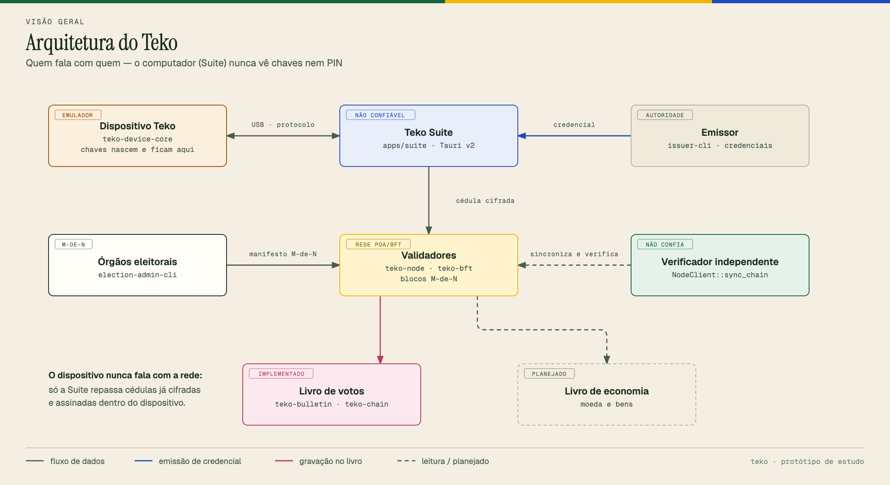
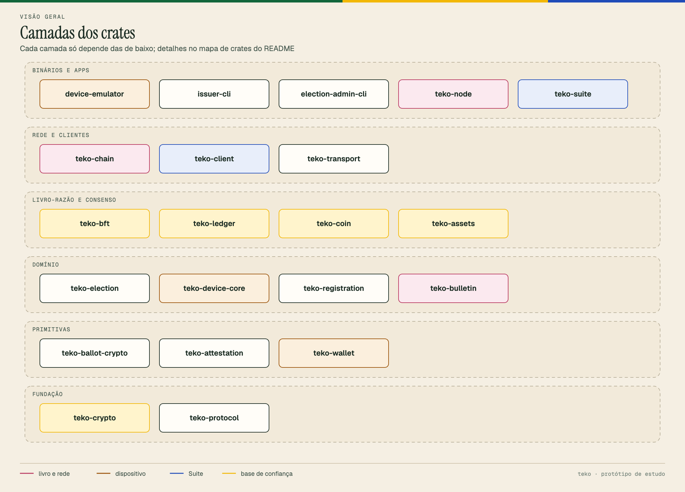

# Teko

**Teko** (guarani: "modo de ser", identidade) é um projeto de estudo: um **dispositivo de identidade cívica** em formato USB (hoje emulado), a **Teko Suite** (app desktop, Tauri v2) e uma **rede federada de validadores** que guarda uma votação com cédulas cifradas. Tudo em Rust.

> Protótipo de estudo. Chaves e PINs são **de teste**; a criptografia é própria e **sem auditoria**; não há valor real nem validade jurídica.

## Arquitetura em uma imagem



O computador (Suite) **nunca** vê chaves nem PIN. O dispositivo cifra e assina a cédula; a Suite só a repassa; os validadores conferem provas e gravam em blocos assinados M-de-N; qualquer um pode refazer a verificação.

## Mapa de crates



| Crate | Papel |
|---|---|
| `teko-protocol` | mensagens, framing e versões do protocolo Suite ↔ dispositivo |
| `teko-crypto` | derivação, hashes etiquetados, ID Cívico (bech32m), assinaturas, credenciais |
| `teko-device-core` | máquina de estados, PIN e armazenamento do dispositivo (`no_std`) |
| `teko-wallet` | carteira: frase BIP-39 de 24 palavras (gerada no dispositivo), derivação SLIP-10 P-256 e endereço `tekow1…`; independente da identidade |
| `teko-attestation` | manifestos de firmware, M-de-N e cadeias de atestação |
| `teko-election` | manifesto da eleição, ciclo de vida dos pleitos, apuração |
| `teko-registration` | registro anônimo por assinatura cega (RFC 9474) |
| `teko-ballot-crypto` | ElGamal de limiar P-256, provas 0/1 e soma, DKG de Feldman |
| `teko-explorer` | índice do explorador: reexecuta e verifica a cadeia de economia e responde blocos, transações, contas, validadores, bens e busca (sem I/O) |
| `devnet-sim` | simuladores só para a rede de teste local: equivocação de um validador (`make devnet-equivocate`), aprovação de credenciais, veto de bens e **blocos sob demanda** (`make devnet-blocks-sim KIND=economy\|votes COUNT=5`); nunca em validador ou release |
| `teko-dev` | **menu de desenvolvimento no terminal** (`make dev`): navegue com as setas, veja se a devnet está de pé e rode os comandos certos para cada estado (subir/derrubar, simular blocos, eleição, credenciais, qualidade); casca sobre o Makefile, só dev, fora de qualquer release |
| `explorer-server` | explorador da chain: página web local + API JSON somente leitura sobre uma cadeia verificada (`make explorer`) |
| `teko-economy` | economia sobre consenso BFT: blocos com certificado de commit, conjunto de validadores por stake com fase de fundador, verificação por clientes |
| `teko-bulletin` | quadro de avisos: log Merkle append-only, provas e head assinado |
| `teko-chain` | blocos M-de-N, perfis devnet/testnet (mainnet travada), réplica verificada |
| `teko-bft` | consenso BFT estilo Tendermint ponderado por stake (ainda fora do nó) |
| `teko-ledger` | livro-razão genérico: transações assinadas, módulos, blocos atômicos e raiz de estado (base da moeda e dos bens) |
| `teko-coin` | moeda de teto fixo: recompensa com *halving*, taxa por byte, stake, penalidade por equivocação e faucet de teste (só devnet) |
| `teko-assets` | bens: classes (imóvel e veículo) governadas por órgão M-de-N, metadados fora da chain com hash amarrado, **negociação direta com janela de veto** (oferta, aceite com escrow, veto do órgão, finalização por qualquer um; cada parte assina a própria transação no dispositivo, ADR-0036) e gravames |
| `teko-credentials` | credenciais na chain: tipos governados por órgão M-de-N (membros por endereço de carteira), emissão por transações de cada membro, janela de contestação, validade, veto e revogação, tudo pelo horário do bloco (ADR-0037) |
| `teko-transport` | trait de transporte e implementação local |
| `teko-client` | cliente da Suite: onboarding, assinatura, eleição |
| `device-emulator` | "tela e botões" do dispositivo, em processo separado |
| `issuer-cli` | autoridade simulada de **teste**: chaves, firmware, eleição de exemplo, registro anônimo e fechamento (a emissão do ID cívico é do app Emissor, ADR-0038) |
| `election-admin-cli` | órgãos eleitorais: publicar, simular votos (rotulados), apurar |
| `teko-node` | validador (gossip, rodízio, DKG) e cliente que não confia em nós |
| `teko-suite` (`apps/suite`) | app Tauri v2 do cidadão: pede e instala a credencial, carteira, bens, votos |
| `teko-issuer` (`apps/issuer`) | **Teko Emissor**: app Tauri v2 em que órgãos emitem credenciais na chain, inclusive o ID cívico, assinando no próprio dispositivo |

## Início rápido (do zero)

Pré-requisitos: Rust (o `rust-toolchain.toml` fixa a versão) e, para a Suite, as dependências do Tauri v2. `make` lista todos os atalhos.

```bash
make dev            # opcional: menu com setas que roda tudo abaixo (e mostra o estado da devnet)
make clean-dev      # opcional: apaga o estado local de testes
make check          # opcional: formato + clippy + testes + docs
make setup          # 1x: chaves de teste, firmware assinado e "fábrica" (pasta dev/)

# 1) O dispositivo e a Suite PRIMEIRO: a carteira do fundador (a sua) nasce no dispositivo.
make emulator       # terminal 1: tela e botões do dispositivo (PIN aqui)
make suite          # terminal 2: onboarding (PIN, carteira com frase de 24 palavras, ID Cívico); copie o endereço tekow1… da aba Carteira
                    # (a credencial cívica vem depois: o órgão a emite no Emissor e você a instala na Suite)

# 2) Só então a rede, com a SUA carteira como fundadora (ela recebe as recompensas)
make devnet FOUNDER=tekow1… [ALLOC=1000] [NODES=4]   # rede de TESTE com 4 instituições por padrão (NODES=3 sobe 3, que não toleram falha; vale na criação da rede): votos e economia em BFT (a cadeia só cresce com voto ou transação); a sua carteira recebe as primeiras moedas (ALLOC TEKO, padrão 1.000) já na gênese, para poder agir sem nenhum bloco antes
make devnet-dkg     # cerimônia de chave entre os validadores (cédulas cifradas)
make candidates    # SIMULA o órgão emitindo as candidaturas de exemplo na chain (ELECTION=geral-2026)
make election       # cria a eleição de exemplo (7 pleitos), com os candidatos das credenciais da chain, e a liga à rede
                    # → reinicie o emulador (terminal 1): ele lê o trust.txt só na partida (a rede também grava ali o órgão do ID cívico)
make issuer         # emite o ID cívico: na Suite, "Pedir a credencial ao órgão"; no Emissor, aba ID cívico; make devnet-cosign; "Entregar o pacote"; na Suite, "Instalar o pacote"
make publish        # publica a eleição no quadro
make simulate N=200 # opcional: eleitores SINTÉTICOS (sempre rotulados)
make devnet-status  # estado da rede     |  make devnet-blocks  # blocos
make tally          # apuração no terminal
make close          # encerra a votação; depois a Suite mostra os gráficos
make claim          # leva à chain os resultados assinados pelas instituições: o eleito recebe a credencial vitalícia
make runoff CONTEST=governador-sp   # abre o 2º turno de um pleito sem maioria absoluta (depois: make publish)
make devnet-stop    # para os validadores
make fund ADDR=tekow1… AMOUNT=1000   # TEKO de TESTE para a sua carteira, aparecem em "Carteira" na Suite (aceita decimais: AMOUNT=0,5; 1 TEKO = 1.000.000 ypy, ADR-0029)
make tally-time     # tempo de verificação do quadro de votos (paralelo; ADR-0033)
make devnet-equivocate  # SIMULA a equivocação do validador de teste e mostra a penalidade (trave stake na Suite antes)
make coin-demo      # demonstração da moeda em memória: teto, halving, taxa, stake e slash
make issuer         # o Teko Emissor: app separado em que órgãos emitem credenciais na chain (precisa do emulador e de make devnet)
make devnet-cosign  # SIMULA os membros de teste dos órgãos aprovando credenciais pendentes (só dev)
make assets-demo    # demonstração dos bens: registro com quórum, gravame, negociação direta com janela de veto e veto do órgão
make devnet-veto CLASS=imovel ASSET=<id>   # SIMULA o órgão vetando uma negociação pendente (dentro da janela)
```

Demo sem teclado (**nunca** em produção): `cargo run -p device-emulator --features test-buttons -- --auto-pin 482913`.

## Estado atual
- **Fase 1** (dispositivo, Suite, emissor): completa.
- **Fase 2** (votação): eleição com vários pleitos e jurisdições, registro anônimo, **cédulas cifradas** até o fechamento, rede de votos em **BFT institucional** (finalidade; sem blocos vazios; ADR-0034), reemissão sem seed (identidade), resultados em gráficos e **carteira com frase de recuperação de 24 palavras** (criada e confirmada no dispositivo, estilo Trezor; ADR-0023).
- **Credenciais na chain (ADR-0037/0038):** CNH, candidatura etc. e o **ID cívico** são emitidos por **órgãos** (quórum M-de-N, cada membro assina no próprio dispositivo) no app **Teko Emissor**, com janela de contestação e validade; a Suite só pede, instala e lê.
- **Recuperar pela carteira (ADR-0039):** a frase de 24 palavras devolve dinheiro, bens, histórico e credenciais (chaves de credencial derivadas da carteira, atributos privados cifrados na chain; Suite ➜ Credenciais ➜ *Recuperar tudo*). Identidade e voto seguem sem seed.
- **O eleitor confere o próprio voto (ADR-0041):** em eleição cifrada o dispositivo **se compromete** com a cédula e o eleitor escolhe, no dispositivo, **votar** ou **auditar** (a cédula auditada é aberta e descartada: pega um dispositivo desonesto com chance ½ por auditoria). Depois, **Conferir minha cédula**: o dispositivo confere **sozinho** o certificado (> 2/3 das instituições do `trust.txt`) e a inclusão; a Suite mostra o veredito da apuração. Não guarda nem mostra em quem você votou: só o **rastreador**.
- **Rotação das instituições (ADR-0045):** o conjunto de instituições da chain de votos deixa de ser fixo: uma troca aprovada por **mais de 2/3 do conjunto em vigor** vale a partir de uma altura (épocas), a economia guarda o conjunto novo, o dispositivo **segue as trocas elo por elo** com uma catraca de época, e a troca é recusada enquanto há eleição em andamento. `make devnet-rotate` (só dev).
- **Certidões de casamento e de divórcio (ADR-0047):** duas credenciais privadas que não vencem; o casamento vale para os dois cônjuges (uma para cada) e o divórcio revoga o casamento; o Emissor tem a aba Certidões e `make devnet-cosign` também completa revogações.
- **Proporcional (ADR-0046):** deputado federal, deputado estadual e vereador: lista aberta com **um voto** (candidato ou legenda), cadeiras por **quociente eleitoral + D'Hondt** com barreiras de 10%/80%/20%, vaga que sobra sem barreira, empate que importa **sorteado** (ADR-0043), até **128 opções** por pleito e voto pelo **número** na Suite; uma `eleito` por vencedor, com o partido.
- **Senador, várias vagas (ADR-0044):** o Senador elege 1 ou 2 pessoas: o eleitor marca **até N candidatos distintos** (ou só branco, ou só nulo), uma prova de faixa na cédula impõe a regra, os N mais votados vencem (corte empatado sorteado) e as N credenciais `eleito` saem numa só reivindicação. Deputados e vereadores (proporcional) seguem pendentes.
- **Desempate por sorteio verificável (ADR-0043):** o empate que a regra não desfaz é decidido por um **VRF de limiar** sobre a chave da cerimônia: cada instituição publica a sua parte, `t` partes dão um ponto único e ninguém controla nem prevê o resultado; qualquer um **refaz o sorteio do quadro** (`election-admin outcomes`). `make tie CONTEST=… VOTES=5,5` planta um empate (só dev).
- **Branco e nulo (ADR-0042):** todo pleito oferece as opções **Branco** e **Nulo** (cifradas como as outras; o dispositivo as mostra com as próprias palavras). A maioria absoluta e o ranking contam **só votos em candidatos**; branco e nulo aparecem na apuração, fora da base.
- **Candidatos, eleito e 2º turno (ADR-0040):** os candidatos são **credenciais** `candidato`; as instituições **assinam o resultado** de cada pleito de vaga única e a economia, com mais de 2/3 das assinaturas, emite a credencial vitalícia **`eleito`** (que o próximo eleito do mesmo cargo e jurisdição sucede); sem maioria absoluta há **2º turno**.
- **Economia sobre BFT (M6a):** a moeda, os bens e o stake rodam em consenso BFT nos nós (`make devnet-economy`), com **fase de fundador** sem pré-mineração (as recompensas vão para a carteira do dono) e validadores por stake depois (ADR-0028); a Suite verifica a cadeia dos nós.
- **Antes disso** (programa do livro-razão): consenso BFT (`teko-bft`) e núcleo do livro (`teko-ledger`) **moeda** (`teko-coin`) e **bens** (`teko-assets`) prontos como biblioteca; a **carteira** já tem endereço, frase de recuperação (M5a) e **envia moedas assinando no dispositivo** (M5b, contra a devnet local de teste); o dispositivo também **assina o seu consentimento na venda de bens** (M5c) a Suite abre numa tela **Início** (resumo) e tem as telas **Validadores** (stake assinado no dispositivo) e **Bens** (venda e compra, com órgão e contraparte **simulados**, só em desenvolvimento); negociação entre pessoas reais e os votos sobre o BFT (M6) ainda só **planejados**.
- **Fora de escopo**: hardware real, validade jurídica (ICP-Brasil), prova ZK de elegibilidade, explorador público (só placeholder).

## Documentação
**Quer entender os conceitos** (hash, assinatura, HRP, consenso BFT, DKG, halving, M-de-N…)? Leia o [guia de conceitos](docs/concepts/README.md), com diagramas e código Rust. Comece por [docs/README.md](docs/README.md): um fluxo curto por assunto, todos em pt-BR e com diagramas ([visão geral](docs/flows/00-overview.md), [assinatura](docs/flows/02-signing.md), [votação](docs/flows/05-encrypted-voting.md), [blocos](docs/flows/09-blocks-and-validation.md), [BFT](docs/flows/11-bft-consensus.md)...). Referência: [ARCHITECTURE](docs/ARCHITECTURE.md), [THREAT-MODEL](docs/THREAT-MODEL.md), [TEST-MATRIX](docs/TEST-MATRIX.md), [ADRs](docs/adr/README.md). Contexto para o assistente: [CLAUDE.md](CLAUDE.md).

## Qualidade e documentação viva
`make check` roda formato, clippy (`-D warnings`), testes e `make docs-check`. Também: `make verify-fw`, `make release-check` (o build normal não tem botões automáticos nem `dev-simulation`) e `make repro` (build reproduzível, [RELEASE](docs/RELEASE.md)). Os diagramas vêm de `scripts/diagrams/` (`make diagrams`; tema em [TEMA](docs/diagrams/THEME.md)). **Regra:** mudou comportamento, comando, crate ou fluxo? Atualize este README e o fluxo correspondente no mesmo trabalho.

> Chaves e PINs aqui são **de teste**. O emulador não tem isolamento de hardware (ver [THREAT-MODEL](docs/THREAT-MODEL.md)).
