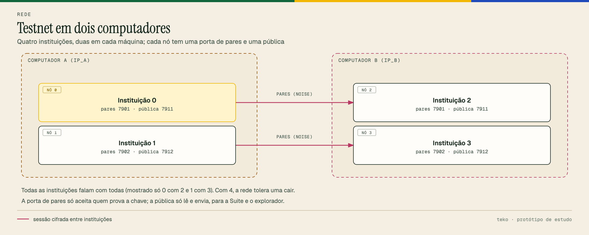

# Testes locais em dois computadores: passo a passo

Este guia é o roteiro curto para rodar a rede **entre dois computadores na mesma rede local** (os "testes locais"). A explicação do desenho está no [ADR-0048](adr/0048-rede-de-testnet-multi-maquina.md) e o runbook geral em [TESTNET](TESTNET.md); aqui só há o que digitar, em ordem.

> **Validado (2026-11-17):** este roteiro foi executado de ponta a ponta em dois computadores na mesma rede local, com todos os passos, **incluindo derrubar validadores**: a rede tolerou uma queda, pausou sem bifurcar com duas e retomou ao subi-los de novo. Escopo: rede local, chaves de teste, dados fictícios. **Ainda não validado:** pela internet, atrás de NAT/roteador com redirecionamento, ou com mais de dois computadores. Se algo falhar, copie a mensagem de erro.

## O plano em uma figura

São **4 instituições** repartidas entre os dois computadores (com 4, a rede continua funcionando se uma cair; com 2 não tolera nenhuma queda):



Cada nó usa **duas portas**: a primeira (79**0**x) é a de **pares** (só as outras instituições entram, com a chave provada) e a segunda (79**1**x) é a **pública** (clientes: só leitura e envio).

## Como ler os comandos

- **[A]** = digite só no computador A. **[B]** = só no B. **[AMBOS]** = nos dois.
- Todos os comandos rodam **na pasta do projeto** (a raiz do repositório), em cada computador.
- `IP_A` e `IP_B` são os endereços dos computadores **na rede** (veja o passo 1). Troque pelos números de verdade, por exemplo `192.168.0.10`.
- `PUB0`, `PUB1`, `PUB2`, `PUB3` são as quatro chaves públicas (textos longos de letras e números) que o passo 3 vai imprimir.

## Passo 0 · Preparar os dois computadores [AMBOS]

```
git pull
cargo build --release -p teko-node
```

O programa fica em `target/release/teko-node`. Para encurtar, use `NODE`:

```
export NODE=target/release/teko-node
```

(Se abrir um terminal novo, digite o `export` de novo.)

**Relógio:** os dois computadores precisam estar com a hora certa (a rede recusa blocos com mais de 60 segundos de diferença). No macOS: Ajustes do Sistema → Geral → Data e Hora → "Definir hora e data automaticamente".

## Passo 1 · Descobrir os endereços [AMBOS]

```
ipconfig getifaddr en0
```

Se não imprimir nada, tente `en1`. O número impresso é o `IP_A` (no A) ou o `IP_B` (no B). Anote os dois.

Teste se um enxerga o outro (de A para B e de B para A):

```
ping -c 2 IP_DO_OUTRO
```

Se não responder, os computadores não estão na mesma rede (ou o Wi-Fi isola os aparelhos): resolva isso antes de continuar.

## Passo 2 · Liberar o firewall [AMBOS]

O macOS pergunta "Deseja permitir conexões de entrada?" quando o programa sobe pela primeira vez: **permita**. Se o firewall estiver ligado e não perguntar, libere o programa `teko-node` em Ajustes do Sistema → Rede → Firewall.

## Passo 3 · Cada computador cria as chaves das suas instituições

**[A]** cria as instituições 0 e 1:

```
$NODE keygen --dir net/node-0
$NODE keygen --dir net/node-1
```

**[B]** cria as instituições 2 e 3:

```
$NODE keygen --dir net/node-2
$NODE keygen --dir net/node-3
```

Cada comando imprime uma linha **"Chave pública (envie esta ao coordenador): …"**. Copie as quatro chaves públicas e junte todas no computador A (por mensagem, por exemplo). As secretas ficam em cada pasta `net/node-N/validator.key` e **nunca saem do computador**.

## Passo 4 · O computador A monta a rede [A]

Crie o arquivo `validators.txt` (na raiz do projeto) com **quatro linhas**, nesta ordem:

```
PUB0  peer=IP_A:7901  public=IP_A:7911
PUB1  peer=IP_A:7902  public=IP_A:7912
PUB2  peer=IP_B:7901  public=IP_B:7911
PUB3  peer=IP_B:7902  public=IP_B:7912
```

(Troque `PUB0`…`PUB3` e `IP_A`/`IP_B` pelos valores de verdade. A ordem das linhas é a ordem das instituições: 0, 1, 2, 3.)

Depois gere a rede:

```
$NODE genesis --dir net --network testnet --validators validators.txt
```

Isso cria `net/network.txt` e `net/peers.txt`.

## Passo 5 · Levar os arquivos para o B

Copie **estes dois arquivos** do A para a pasta `net/` do B (pen drive, `scp`, AirDrop… qualquer meio):

- `net/network.txt`
- `net/peers.txt`

Por exemplo, do A:

```
scp net/network.txt net/peers.txt USUARIO_B@IP_B:CAMINHO_DO_PROJETO/net/
```

No B, a pasta `net/` já existe (foi criada pelo `keygen`).

## Passo 6 · Conferir se os dois têm a MESMA rede [AMBOS]

```
$NODE genesis-hash --dir net
```

Vai imprimir um texto de 64 letras e números. **Tem de ser idêntico nos dois computadores.** Se for diferente, os arquivos do passo 5 não são os mesmos: copie de novo. Sem isso, os nós se recusam a conversar.

## Passo 7 · Subir os 4 nós

Use **um terminal por nó** (deixe-os abertos; para parar um nó, Ctrl+C no terminal dele).

**[A], terminal 1 (instituição 0):**

```
$NODE run --dir net --index 0 --listen-peer 0.0.0.0:7901 --listen-public 0.0.0.0:7911 --advertise-peer IP_A:7901 --advertise-public IP_A:7911 --allow-remote
```

**[A], terminal 2 (instituição 1):**

```
$NODE run --dir net --index 1 --listen-peer 0.0.0.0:7902 --listen-public 0.0.0.0:7912 --advertise-peer IP_A:7902 --advertise-public IP_A:7912 --allow-remote
```

**[B], terminal 1 (instituição 2):**

```
$NODE run --dir net --index 2 --listen-peer 0.0.0.0:7901 --listen-public 0.0.0.0:7911 --advertise-peer IP_B:7901 --advertise-public IP_B:7911 --allow-remote
```

**[B], terminal 2 (instituição 3):**

```
$NODE run --dir net --index 3 --listen-peer 0.0.0.0:7902 --listen-public 0.0.0.0:7912 --advertise-peer IP_B:7902 --advertise-public IP_B:7912 --allow-remote
```

Cada um imprime uma linha como `validador 0 de 4 em …`. O `--allow-remote` é o que autoriza o nó a escutar fora do próprio computador (sem ele, ele recusa de propósito).

## Passo 8 · Ver se funcionou

Em **qualquer** dos computadores, num terminal novo:

```
export NODE=target/release/teko-node
$NODE status --dir net
```

O que esperar: os quatro nós aparecem, cada um com **3 pares online** (pode levar alguns segundos). Se aparecerem 0 ou 1 pares, vá para "Se algo der errado" no fim.

Agora force o consenso a **decidir um bloco entre os dois computadores**. Em **[A]**:

```
$NODE dkg --dir net
$NODE blocks --dir net
```

O `dkg` faz a cerimônia de chave da eleição entre os quatro nós (cada parte da chave passa pelo canal cifrado entre as instituições) e registra o resultado na chain. O `blocks` baixa e **reverifica** os blocos como um cliente que não confia em ninguém. Se os dois comandos terminarem sem erro, **a rede funciona entre as máquinas**.

## Passo 9 · Testes que vale a pena fazer

1. **Uma instituição cai e a rede continua.** Pare o nó 3 (Ctrl+C no terminal dele) e rode `$NODE dkg --dir net` de novo, ou apenas `$NODE status --dir net`: com 3 de 4, a chain segue.
2. **Duas caem e a rede pausa (sem bifurcar).** Pare também o nó 2: o `status` mostra a altura parada. Suba os dois de novo (o mesmo comando do passo 7): ela retoma sozinha.
3. **Um estranho é barrado.** De um terceiro computador (ou do A para o B), rode `nc IP_B 7901` e digite qualquer coisa: a conexão tem que cair, sem resposta nenhuma.
4. **A porta pública responde a qualquer um da rede.** Em qualquer computador: `$NODE status --dir net` funciona (ele usa as portas públicas, 7911 e 7912).

## Se algo der errado

| O que você vê | Provável causa | O que fazer |
|---|---|---|
| `another genesis` | `network.txt` ou `peers.txt` diferentes entre os computadores | refaça o passo 5 e confira o passo 6 |
| Os nós sobem mas `status` mostra 0 ou 1 par | firewall bloqueando, ou `--advertise-*` com o IP errado | refaça o passo 2; teste `nc -vz IP_DO_OUTRO 7901` |
| O nó se recusa a subir (`only listens on loopback`) | faltou `--allow-remote` | acrescente no fim do comando |
| `not a validator in force` | a chave do nó não é a do `validators.txt` (ordem errada ou chave trocada) | confira se cada `PUBn` é a chave da pasta `net/node-n` |
| `this key is not validator index` | você subiu o nó com o `--index` errado | use o índice da linha do `validators.txt` |
| Os blocos não avançam | menos de mais de 2/3 dos nós no ar, ou relógios com mais de 60 s de diferença | confira os 4 terminais e a hora |
| Uma instituição "some" por uns 10 minutos | banimento automático por mau comportamento (versão ou relógio errados) | corrija e espere; some sozinho |

Para **recomeçar do zero**: pare os 4 nós, apague a pasta `net/` nos dois computadores e volte ao passo 3.

## Simular blocos e ver quem assinou

A rede só faz blocos quando há atividade. Os comandos abaixo rodam **em qualquer um dos computadores**, na raiz do projeto, e falam com os nós pelas **portas públicas** do `peers.txt` (por isso funcionam de A ou de B). Sempre com `NET=net`, que é a pasta desta rede.

### 1. Blocos de votos (todas as instituições assinam)

```
make devnet-blocks-sim NET=net KIND=votes COUNT=5
make devnet-blocks NET=net
```

O primeiro comando coloca 5 entradas, uma por bloco. O segundo lista os blocos **verificados aqui**, e agora diz quem assinou, com a instituição e o computador:

```
#7 · 1 entradas · rodada 0 · proposto por 2 (192.168.0.11)
    assinaram 3 instituição(ões) em 2 computador(es): 0 (192.168.0.10), 2 (192.168.0.11), 3 (192.168.0.11)
```

Rode o `devnet-blocks` nos **dois** computadores: os dois baixam os blocos dos nós, reverificam sozinhos os certificados e têm de mostrar **o mesmo**. O proponente muda de bloco em bloco (é sorteado por rodada); as assinaturas vêm de instituições dos dois computadores. Derrubar um nó e simular mais blocos mostra o bloco sendo decidido sem ele.

### 2. Explorador (precisa de economia)

O explorador mostra a economia e o livro de votos, então **a rede precisa ter economia**. Se você montou a rede só com o `genesis` (sem `economy-init`), faça agora:

1. Em **[A]**, `$NODE economy-init --dir net` (sem `--founder`, as recompensas vão para uma conta de teste do nó 0; com `--founder tekow1…` vão para a carteira do seu dispositivo).
2. Copie `net/economy.txt` do A para a pasta `net/` do B e **confira o `genesis-hash` nos dois** (o hash muda quando a economia entra).
3. Pare os 4 nós (Ctrl+C) e suba de novo (passo 7). A cadeia de votos que já existe continua.

Depois, em qualquer computador:

```
make explorer NET=net
```

e abra **http://127.0.0.1:8545**. A página **Livro de votos** tem a coluna "Assinaram (instituição e computador)". As páginas de blocos, transações, contas e validadores são da economia.

### 3. Blocos de economia (bens, credenciais, moeda)

Bens e credenciais são transações da **economia**:

```
make devnet-blocks-sim NET=net KIND=economy COUNT=5
make devnet-economy NET=net
```

**Importante, para você não estranhar:** na economia quem assina o bloco é o **validador por stake**, e no começo da rede (fase de fundador) o único validador é o **nó 0**. Os outros nós **replicam e conferem** (todos veem o mesmo bloco), mas só o nó 0 assina. Para a economia ter assinaturas de computadores diferentes é preciso que mais validadores façam **stake** (aba Carteira da Suite, ADR-0028); isso ainda não está neste roteiro. **Para ver computadores diferentes assinando hoje, use os blocos de votos** (item 1).

Os bens e as credenciais de verdade (não os blocos "de enchimento") se criam pelo Emissor e pela Suite, apontando para esta rede; isso também fica para depois.

## Depois dos testes locais

Os passos acima já foram validados. O que vem em seguida, na ordem:

1. Fazer mais de um validador da **economia** assinar (stake) e apontar a Suite e o Emissor para esta rede (hoje só o explorador e os simuladores usam a pasta `net/`).
2. Testar com mais de dois computadores e, depois, **pela internet** (precisa de redirecionamento de portas ou de um endereço público; não há NAT traversal, ver os limites no [ADR-0048](adr/0048-rede-de-testnet-multi-maquina.md)).
