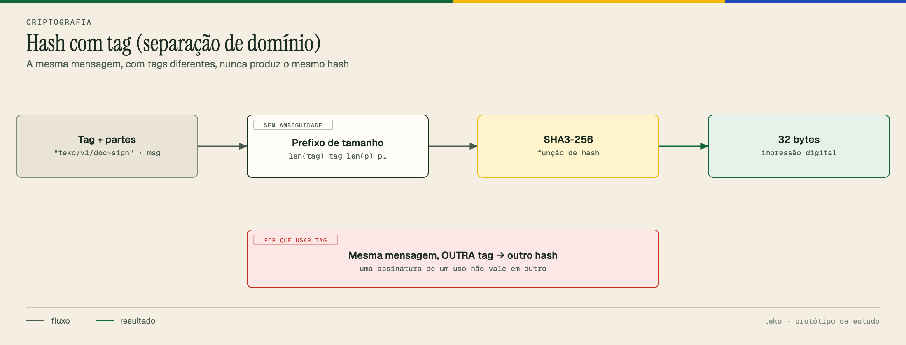

# 1. Hash e hash com tag

## O que é
Um **hash** transforma qualquer dado em uma "impressão digital" de tamanho fixo (32 bytes no SHA3-256). Três propriedades importam: o mesmo dado sempre dá o mesmo hash; mudar **um bit** muda o hash inteiro; e não dá para voltar do hash ao dado. Analogia: a impressão digital de uma pessoa identifica sem permitir reconstruí-la.

## Por que o Teko usa
Hash está em tudo: ID Cívico, endereço da carteira, id de bloco, raiz do estado, raiz de Merkle, chaves derivadas. Como é tão usado, existe um risco: um hash feito para um propósito ser aceito em outro. A defesa é o **hash com tag** (separação de domínio): cada uso tem um rótulo único e versionado, como `teko/v1/doc-sign`, que entra no cálculo. A mesma mensagem com outra tag dá outro hash, então uma assinatura de documento nunca vale como assinatura de transação.

Além da tag, cada pedaço entra com o **tamanho na frente**. Sem isso, `("ab","c")` e `("a","bc")` virariam os mesmos bytes e colidiriam.



## Código
Exemplo que espelha o `tagged_hash` do Teko. Depende do crate `sha3`.

```rust
// depende de: sha3
use sha3::{Digest, Sha3_256};

/// SHA3-256 sobre: tamanho da tag, tag, e (tamanho, bytes) de cada parte.
fn tagged_hash(tag: &str, parts: &[&[u8]]) -> [u8; 32] {
    let mut h = Sha3_256::new();
    h.update((tag.len() as u32).to_be_bytes());
    h.update(tag.as_bytes());
    for p in parts {
        h.update((p.len() as u32).to_be_bytes());
        h.update(p);
    }
    h.finalize().into()
}

fn main() {
    let msg = b"transferir 10 TEKO";
    let a = tagged_hash("teko/v1/doc-sign", &[msg]);
    let b = tagged_hash("teko/v2/block", &[msg]);
    assert_ne!(a, b); // mesma mensagem, outra tag, outro hash

    // fronteiras não se confundem: ("ab","c") != ("a","bc")
    let x = tagged_hash("t", &[b"ab", b"c"]);
    let y = tagged_hash("t", &[b"a", b"bc"]);
    assert_ne!(x, y);

    println!("{:02x?}", &a[..4]);
}
```

## Onde está no Teko
- `crates/teko-crypto/src/keys.rs`: `tagged_hash`; as tags ficam em `crates/teko-crypto/src/tags.rs` (`teko/v1/…` para a identidade, `teko/v2/…` para blocos, quadro e votação).
- Derivação de chaves por finalidade: `derive_key(raiz, tag)`.
- Teste: `tag_and_part_boundaries_are_unambiguous` e `domain_separation` (proptest).

## Cuidados
- SHA3 não sofre o ataque de extensão de tamanho do SHA-2, então um hash com chave é um PRF razoável; a migração para KMAC está registrada como pergunta aberta em `docs/KEY-HIERARCHY.md`.
- Hash **não é cifra**: quem adivinha a entrada confere o hash. Por isso o PIN não é só um hash; ver [capítulo 10](10-device-security.md).
