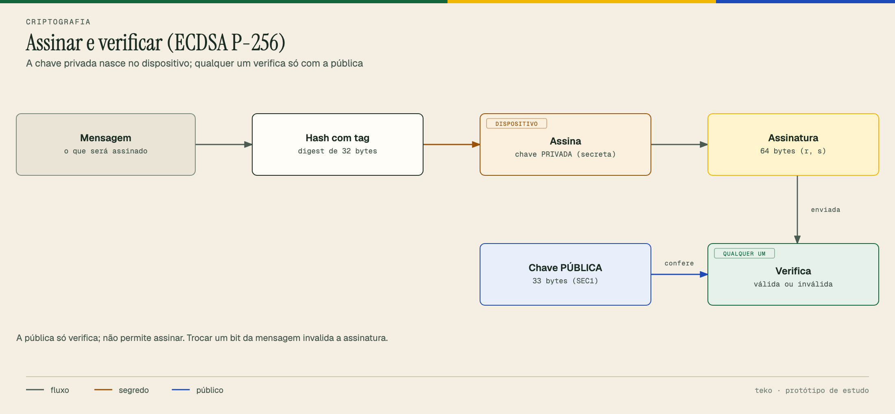

# 2. Chaves e assinaturas

## O que é
Uma **assinatura digital** prova duas coisas: que quem tem a **chave privada** autorizou aquela mensagem, e que a mensagem não mudou depois. A chave privada é segredo; a **chave pública** é divulgada e só serve para **verificar**. Analogia: a privada é o seu carimbo pessoal; a pública é a lupa que qualquer um usa para conferir o carimbo, sem poder fabricá-lo.

## Qual assinatura o Teko usa
**ECDSA sobre a curva P-256**, assinando o **hash com tag** da mensagem (capítulo 1). A assinatura tem 64 bytes (r, s) e a chave pública comprimida tem 33 bytes (formato SEC1). Escolhemos P-256 porque é padrão, tem implementação madura em Rust (`p256`) e é compatível com o hardware seguro que existe no mundo (ADR-0002).

No Teko a chave privada **nasce no dispositivo e nunca sai dele**. A Suite só recebe assinaturas.



## Código
Para entender a **ideia**, um exemplo de **brinquedo** (assinatura de Schnorr com números pequenos e hash fraco). A ECDSA real é diferente na conta, mas tem a mesma forma: um segredo, um valor público derivado dele, assinar e verificar. **Não use isto para nada real.**

```rust
// BRINQUEDO, inseguro de propósito: números minúsculos, hash fraco.
use std::collections::hash_map::DefaultHasher;
use std::hash::{Hash, Hasher};

const P: u128 = 2_147_483_647; // primo
const G: u128 = 7; // gerador
const Q: u128 = P - 1; // ordem do grupo

fn pot(mut b: u128, mut e: u128, m: u128) -> u128 {
    let mut r = 1;
    b %= m;
    while e > 0 {
        if e & 1 == 1 { r = r * b % m; }
        b = b * b % m;
        e >>= 1;
    }
    r
}

fn h(r: u128, msg: &str) -> u128 {
    let mut s = DefaultHasher::new();
    (r, msg).hash(&mut s);
    s.finish() as u128 % Q
}

/// Assina: devolve (r, s). `k` deveria ser aleatório e único por assinatura.
fn assinar(x: u128, k: u128, msg: &str) -> (u128, u128) {
    let r = pot(G, k, P);
    let e = h(r, msg);
    (r, (k + e * x) % Q)
}

/// Verifica só com a chave pública y = g^x: g^s == r * y^e.
fn verificar(y: u128, msg: &str, (r, s): (u128, u128)) -> bool {
    let e = h(r, msg);
    pot(G, s, P) == r * pot(y, e, P) % P
}

fn main() {
    let x = 123_456_789; // chave PRIVADA
    let y = pot(G, x, P); // chave PÚBLICA
    let sig = assinar(x, 987_654_321, "pagar 10 TEKO");
    assert!(verificar(y, "pagar 10 TEKO", sig));
    assert!(!verificar(y, "pagar 99 TEKO", sig)); // mensagem alterada
    println!("assinatura válida só para a mensagem original");
}
```

A chamada **real** do Teko (não executável aqui, depende do crate):

```rust,ignore
// crates/teko-crypto/src/sign.rs
pub fn sign_tagged(key: &SigningKey, tag: &str, msg: &[u8]) -> Vec<u8> {
    let digest = tagged_hash(tag, &[msg]); // 1) hash com tag
    let sig: Signature = key.sign(&digest); // 2) ECDSA P-256
    sig.to_bytes().to_vec() // 64 bytes
}
```

## Onde está no Teko
- `crates/teko-crypto/src/sign.rs`: `sign_tagged` e `verify_tagged`; chaves em `keys.rs` (`generate_signing_key`, `public_key_bytes`).
- Quem assina o quê: identidade, documento, cédula, transação, voto do BFT; cada uso com a sua tag.
- Fluxos: [assinatura de documento](../flows/02-signing.md).

## Cuidados
- ECDSA exige um número aleatório (nonce) bom por assinatura; as bibliotecas modernas usam a variante determinística (RFC 6979). Um nonce repetido vaza a chave privada.
- Uma assinatura só vale para **aquela tag**: por isso a tag entra no hash.
- Sem auditoria.
