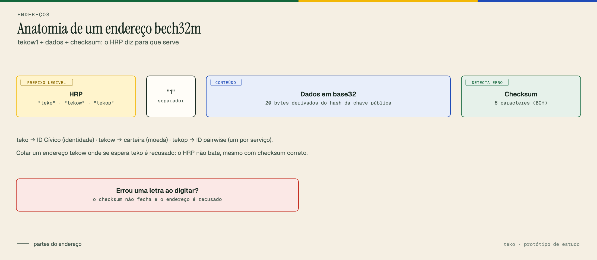

# 3. Endereços e HRP (bech32m)

## O que é
**bech32m** é um formato de texto para endereços: legível, só com letras minúsculas e dígitos, e com um **checksum** que detecta erros de digitação. Um endereço tem três partes: o **HRP**, o separador `1` e os dados com o checksum.

**HRP** significa *human-readable part*: a parte legível por humanos, o prefixo que diz **para que serve** o endereço. No Teko há três:

| HRP | Exemplo | Para que serve |
|---|---|---|
| `teko` | `teko1…` | **ID Cívico** (a identidade da pessoa) |
| `tekow` | `tekow1…` | **Carteira** (endereço da moeda) |
| `tekop` | `tekop1…` | **ID pairwise** (um identificador diferente por serviço) |

Analogia: o HRP é a cor do envelope, e o checksum é o dígito verificador do CPF.

## Por que o Teko usa
1. **Evita trocas perigosas:** colar um endereço de carteira onde se espera um ID Cívico é recusado, porque o HRP não bate, mesmo com o checksum correto.
2. **Pega digitação errada:** trocar, apagar ou inverter letras quebra o checksum.
3. **Dados curtos:** o conteúdo são 20 bytes derivados do hash da chave pública (capítulo 1), então o endereço não revela a chave.



## Código
Implementação **completa e real** do bech32m (a mesma conta do BIP-350), só com a biblioteca padrão. O checksum é um código BCH calculado com um polinômio; a constante `0x2bc830a3` é o que diferencia o bech32m do bech32 antigo.

```rust
const CHARSET: &[u8] = b"qpzry9x8gf2tvdw0s3jn54khce6mua7l";
const GEN: [u32; 5] = [0x3b6a57b2, 0x26508e6d, 0x1ea119fa, 0x3d4233dd, 0x2a1462b3];
const BECH32M_CONST: u32 = 0x2bc830a3;

fn polymod(valores: &[u8]) -> u32 {
    let mut chk: u32 = 1;
    for v in valores {
        let topo = chk >> 25;
        chk = ((chk & 0x1ffffff) << 5) ^ (*v as u32);
        for (i, g) in GEN.iter().enumerate() {
            if (topo >> i) & 1 == 1 { chk ^= g; }
        }
    }
    chk
}

fn expandir_hrp(hrp: &str) -> Vec<u8> {
    let mut v: Vec<u8> = hrp.bytes().map(|b| b >> 5).collect();
    v.push(0);
    v.extend(hrp.bytes().map(|b| b & 31));
    v
}

/// 8 bits por byte -> grupos de 5 bits.
fn para_5_bits(dados: &[u8]) -> Vec<u8> {
    let (mut acc, mut bits, mut out) = (0u32, 0u32, Vec::new());
    for b in dados {
        acc = (acc << 8) | *b as u32;
        bits += 8;
        while bits >= 5 {
            bits -= 5;
            out.push(((acc >> bits) & 31) as u8);
        }
    }
    if bits > 0 { out.push(((acc << (5 - bits)) & 31) as u8); }
    out
}

fn checksum(hrp: &str, dados5: &[u8]) -> Vec<u8> {
    let mut v = expandir_hrp(hrp);
    v.extend(dados5);
    v.extend([0u8; 6]);
    let m = polymod(&v) ^ BECH32M_CONST;
    (0..6).map(|i| ((m >> (5 * (5 - i))) & 31) as u8).collect()
}

fn codificar(hrp: &str, dados: &[u8]) -> String {
    let d5 = para_5_bits(dados);
    let mut s = format!("{hrp}1");
    for x in d5.iter().chain(checksum(hrp, &d5).iter()) {
        s.push(CHARSET[*x as usize] as char);
    }
    s
}

fn confere(texto: &str) -> bool {
    let Some(pos) = texto.rfind('1') else { return false };
    let (hrp, resto) = (&texto[..pos], &texto[pos + 1..]);
    let mut v = expandir_hrp(hrp);
    for c in resto.bytes() {
        match CHARSET.iter().position(|x| *x == c) {
            Some(i) => v.push(i as u8),
            None => return false,
        }
    }
    polymod(&v) == BECH32M_CONST
}

fn main() {
    // vetor de teste oficial do BIP-350: dados vazios, HRP "a"
    assert_eq!(codificar("a", &[]), "a1lqfn3a");

    let carteira = codificar("tekow", &[7u8; 20]);
    assert!(confere(&carteira));

    // um erro de digitação é pego pelo checksum
    let mut errado = carteira.clone().into_bytes();
    let i = errado.len() - 3;
    errado[i] = if errado[i] == b'q' { b'p' } else { b'q' };
    assert!(!confere(&String::from_utf8(errado).unwrap()));

    println!("{carteira}");
}
```

## Onde está no Teko
- `crates/teko-crypto/src/ids.rs`: constantes `CIVIC_HRP`, `PAIRWISE_HRP`, `WALLET_HRP`; `civic_id`, `wallet_address`, `parse_civic_id` e `parse_wallet_address` (validam checksum **e** HRP).
- O Teko usa o crate `bech32`; o exemplo acima é a mesma conta, escrita à mão para você ver o que acontece.
- Teste: o ID Cívico tem checksum válido e detecta erros de digitação (TEST-MATRIX).

## Cuidados
- O checksum **detecta** erro, não corrige.
- O endereço é público. Quem o vê não ganha poder sobre ele; no máximo sabe que ele existe.
