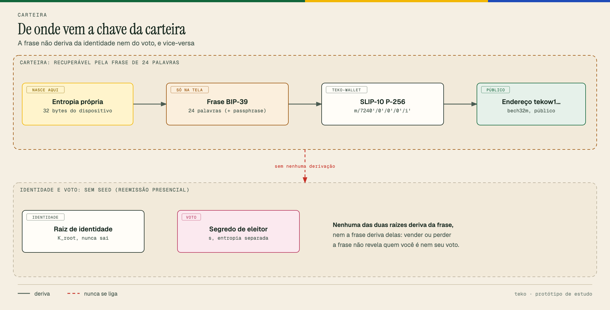

# 4. Carteira: frase de recuperação, derivação e TEKO/ypy

## O que é
A **carteira** guarda a chave que controla suas moedas. Em vez de você guardar um arquivo de chave, o dispositivo mostra uma **frase de recuperação** de 24 palavras (padrão **BIP-39**). Quem tem a frase recupera a carteira em qualquer dispositivo; por isso ela vale dinheiro e **só aparece na tela do dispositivo**, uma vez. Uma **passphrase** opcional (senha extra) muda a carteira inteira: a mesma frase com outra passphrase leva a outra carteira.

Da frase sai uma **semente** de 64 bytes. Dela, a **derivação hierárquica** (**SLIP-10** para a curva P-256) cria chaves filhas por um **caminho**. O da carteira do Teko é:

```
m / 7240' / 0' / 0' / 0' / i'
```

O apóstrofo (`'`) marca derivação **endurecida** (*hardened*): saber uma chave filha e a chave pública do pai **não** revela as outras. `7240` é o "propósito" do Teko.



## Por que o Teko usa
- Frase de 24 palavras: **256 bits** de entropia mais 8 bits de checksum (24 × 11 = 264 bits). O checksum pega erro de anotação.
- A carteira é **independente da identidade**: nenhuma chave da identidade ou do voto é derivável dela, nem o contrário (princípio 5 do projeto). A identidade e o voto seguem **sem seed**.
- Única exceção ao "chave nunca sai do dispositivo": a frase, mostrada ao humano (ADR-0023).

## Moeda: TEKO e ypy
O livro guarda inteiros em **ypy**, a menor unidade; **1 TEKO = 1.000.000 ypy** (6 casas decimais, como o Bitcoin tem satoshis). Assim não há ponto flutuante, e nada é arredondado ([ADR-0029](../adr/0029-unidade-teko-e-ypy.md)).

## Código
Exemplo std-only: aritmética da frase, índice endurecido e a conversão ypy → TEKO.

```rust
const YPY_POR_TEKO: u64 = 1_000_000;
const ENDURECIDO: u32 = 0x8000_0000; // bit alto marca o índice como endurecido

/// Índice endurecido: 7240' vira 7240 | 0x8000_0000.
fn endurecer(i: u32) -> u32 { i | ENDURECIDO }

/// Caminho da carteira do Teko para a i-ésima conta.
fn caminho(i: u32) -> [u32; 5] {
    [endurecer(7240), endurecer(0), endurecer(0), endurecer(0), endurecer(i)]
}

/// 1.234,5 TEKO a partir de ypy, só com inteiros (sem f64).
fn formatar(ypy: u64) -> String {
    let inteiro = (ypy / YPY_POR_TEKO).to_string();
    let mut agrupado = String::new();
    for (i, c) in inteiro.chars().enumerate() {
        if i > 0 && (inteiro.len() - i) % 3 == 0 { agrupado.push('.'); }
        agrupado.push(c);
    }
    let frac = ypy % YPY_POR_TEKO;
    if frac == 0 {
        format!("{agrupado} TEKO")
    } else {
        format!("{agrupado},{} TEKO", format!("{frac:06}").trim_end_matches('0'))
    }
}

fn main() {
    // 24 palavras de 11 bits = 264 bits = 256 de entropia + 8 de checksum
    assert_eq!(24 * 11, 256 + 8);

    assert_eq!(caminho(0)[0], 0x8000_1C48); // 7240 = 0x1C48
    println!("{:x?}", caminho(3));

    assert_eq!(formatar(1_234_500_000), "1.234,5 TEKO");
    assert_eq!(formatar(162), "0,000162 TEKO");
    assert_eq!(formatar(21_000_000 * YPY_POR_TEKO), "21.000.000 TEKO");
}
```

## Onde está no Teko
- `crates/teko-wallet/src/lib.rs`: `PURPOSE = 7240`, frase, `master_key(passphrase)` e o endereço `tekow1…` ([capítulo 3](03-addresses-bech32m.md)). Vetor oficial do SLIP-10 para `nist256p1` nos testes.
- `crates/teko-crypto/src/amount.rs`: `format_amount` e `parse_amount`.
- Fluxo: [Carteira e frase de recuperação](../flows/14-wallet-and-seed.md).

## Cuidados
- Esquecer a **passphrase** = perder os fundos; ela não é recuperável.
- No emulador a frase passa por um terminal comum; em hardware real ficaria só na tela segura do dispositivo.
