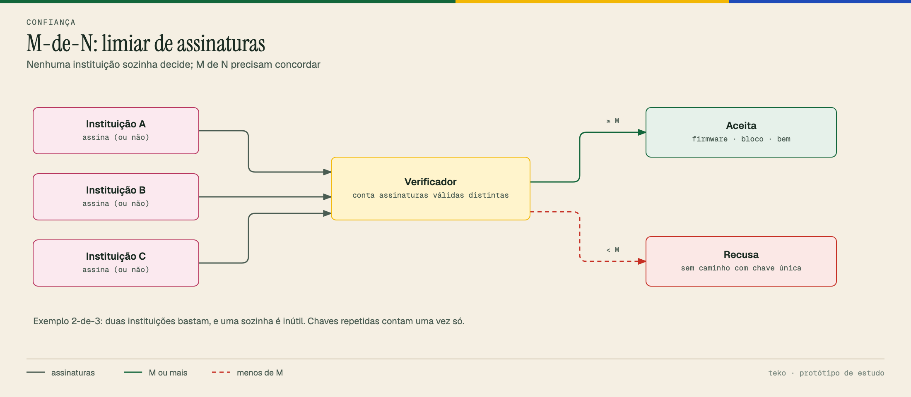

# 5. M-de-N: limiar de assinaturas

## O que é
**M-de-N** (também "limiar" ou *threshold*) é a regra: existem **N** chaves autorizadas, e uma ação só vale com **M** assinaturas válidas e **de chaves diferentes**. Exemplo 2-de-3: três instituições independentes, e duas bastam. Analogia: um cofre com três chaves, que abre com duas.

## Por que o Teko usa
Para que **ninguém sozinho** possa fazer algo grave. O Teko usa M-de-N em dois lugares (o livro de votos já não usa: ele decide por BFT, ADR-0034):
1. **Firmware** do dispositivo: só roda se assinado por M de N instituições independentes. Não existe caminho de código com chave única; downgrade é recusado.
2. **Bens:** uma classe de bens (por exemplo `imovel`) é governada por um órgão M-de-N, que registra a classe e pode aplicar gravames.

Não confunda com o **limiar criptográfico** da votação (capítulo 9), onde M de N guardiões juntam **partes de uma mesma chave** para decifrar. Lá ninguém tem a chave inteira; aqui cada um assina separadamente e o verificador conta.



## Código
Exemplo std-only da regra de contagem. A verificação criptográfica de cada assinatura (capítulo 2) está simulada por um campo `valida`.

```rust
use std::collections::HashSet;

struct Assinatura {
    chave: u32,     // quem assinou
    valida: bool,   // a verificação ECDSA passou? (simulada)
}

/// Aceita se ao menos `m` chaves AUTORIZADAS e DISTINTAS assinaram corretamente.
fn m_de_n(autorizadas: &[u32], m: usize, assinaturas: &[Assinatura]) -> bool {
    let validas: HashSet<u32> = assinaturas
        .iter()
        .filter(|a| a.valida && autorizadas.contains(&a.chave))
        .map(|a| a.chave) // o conjunto descarta repetições
        .collect();
    validas.len() >= m
}

fn main() {
    let autorizadas = [1, 2, 3];
    let boa = |c| Assinatura { chave: c, valida: true };

    assert!(m_de_n(&autorizadas, 2, &[boa(1), boa(3)])); // 2 de 3: aceita
    assert!(!m_de_n(&autorizadas, 2, &[boa(2)])); // só 1: recusa
    assert!(!m_de_n(&autorizadas, 2, &[boa(2), boa(2)])); // mesma chave 2x conta 1
    assert!(!m_de_n(&autorizadas, 2, &[boa(1), boa(99)])); // 99 não é autorizada
    println!("regra M-de-N ok");
}
```

## Onde está no Teko
- Firmware: `crates/teko-attestation` (manifesto M-de-N, anti-downgrade); `make verify-fw` confere de forma independente da Suite.
- Bens: `crates/teko-assets` (órgão M-de-N da classe).
- Testes: firmware sem M-de-N é recusado; downgrade é recusado (TEST-MATRIX).

## Cuidados
- M-de-N só protege se as N instituições forem **realmente independentes**; se uma controla várias chaves, o limiar perde o sentido.
- Escolher M é um equilíbrio: M alto = mais seguro contra abuso, mas mais difícil de atingir (e um bloqueio de N−M+1 instituições trava tudo).
