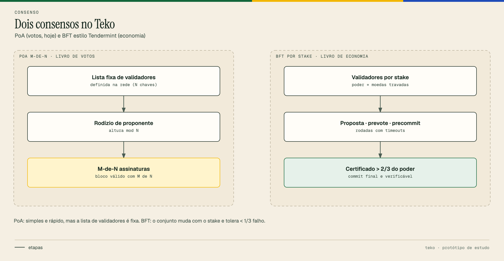

# 6. Consenso: PoA e BFT

## O que é
**Consenso** é como vários computadores, que não confiam uns nos outros, **concordam sobre a mesma sequência de blocos**, mesmo com falhas ou traidores. Sem isso, cada um teria um livro diferente.

## Qual algoritmo o Teko usa
Dois, um para cada livro:

| | Livro de **votos** (hoje) | Livro de **economia** |
|---|---|---|
| Algoritmo | **PoA** (*proof of authority*) M-de-N | **BFT estilo Tendermint**, ponderado por stake |
| Quem valida | lista fixa de N validadores | quem tem moedas travadas (*stake*) |
| Bloco é final quando | M de N assinaram | mais de 2/3 do poder votou (certificado de commit) |
| Tolera | falha de até N−M validadores | até 1/3 do poder falho ou malicioso |

A migração do livro de votos para o BFT é o **M6b**, planejado.



## PoA em uma frase
Um validador da vez (rodízio por altura) propõe o bloco; ele só vale com M assinaturas de N. É simples e rápido, mas a lista de validadores é fixa. Ver [capítulo 5](05-m-of-n.md).

## BFT (Tendermint) passo a passo
BFT = *Byzantine Fault Tolerance*: tolerância a falhas "bizantinas", em que o defeituoso pode mentir e agir de má-fé. Em cada **altura** (número do bloco) há **rodadas**:

1. **Proposta:** o proponente da rodada (sorteado de forma determinística e ponderada pelo poder) propõe um bloco.
2. **Prevote:** cada validador vota no bloco se ele for válido (ou em "nada").
3. **Precommit:** se viu **mais de 2/3** dos prevotes no mesmo bloco, o validador **trava (lock)** nesse bloco e dá precommit.
4. **Commit:** com **mais de 2/3** de precommits o bloco é decidido. Esses precommits assinados formam o **certificado de commit**, uma prova portátil que qualquer um verifica.
5. Se o tempo estoura (*timeout*), vem a **rodada seguinte** com outro proponente e prazo maior.


### Por que "mais de 2/3"?
Dois grupos com mais de 2/3 do poder cada **se sobrepõem em mais de 1/3**. Se menos de 1/3 for traidor, nessa interseção há alguém honesto, e o honesto só vota **uma vez por rodada**. Logo, dois blocos diferentes nunca são decididos na mesma altura (**segurança**).


### Lock, equivocação e slash
- **Lock:** depois de dar precommit num bloco, o validador não prevota outro bloco nas rodadas seguintes. Por isso ele é gravado em disco **antes** do voto sair (`economy.wal`, [ADR-0030](../adr/0030-slash-automatico-e-bloqueio-persistido.md)): um reinício não faz esquecer.
- **Equivocação:** assinar dois votos conflitantes (mesma altura, rodada e tipo). Os dois votos assinados são uma **evidência**, que qualquer um verifica.
- **Slash:** o nó que vê a evidência envia uma transação que **queima parte do stake** do traidor, uma vez por ofensa.


## Código
Std-only: o teste de quórum do Teko, o sorteio ponderado do proponente e o formato do WAL.

```rust
/// Mais de 2/3 do poder total. Multiplica em vez de dividir: sem decimais.
fn quorum(poder: u64, total: u64) -> bool {
    poder * 3 > total * 2
}

/// Sorteio ponderado e determinístico: um número derivado de (altura, rodada)
/// cai numa "fatia" proporcional ao poder de cada validador.
/// (O Teko deriva esse número com um hash com tag; aqui, uma mistura simples.)
fn proponente(poderes: &[u64], altura: u64, rodada: u32) -> usize {
    let total: u64 = poderes.iter().sum();
    let sorteio = altura
        .wrapping_mul(6364136223846793005)
        .wrapping_add(rodada as u64 * 1442695040888963407)
        .rotate_left(17);
    let mut fatia = sorteio % total;
    for (i, p) in poderes.iter().enumerate() {
        if fatia < *p { return i; }
        fatia -= *p;
    }
    0
}

/// Linha do WAL: "altura rodada [rodada_do_lock id_hex]".
fn ler_wal(linha: &str) -> Option<(u64, u32, Option<(u32, String)>)> {
    let mut it = linha.split_whitespace();
    let altura = it.next()?.parse().ok()?;
    let rodada = it.next()?.parse().ok()?;
    let lock = match (it.next(), it.next()) {
        (Some(r), Some(id)) => Some((r.parse().ok()?, id.to_string())),
        _ => None,
    };
    Some((altura, rodada, lock))
}

fn main() {
    // total 100: 67 é quórum, 66 não
    assert!(quorum(67, 100));
    assert!(!quorum(66, 100));

    // quem tem mais poder propõe mais vezes (estatístico)
    let poderes = [70, 20, 10];
    let mut cont = [0u32; 3];
    for h in 0..10_000 { cont[proponente(&poderes, h, 0)] += 1; }
    assert!(cont[0] > cont[1] && cont[1] > cont[2]);

    assert_eq!(ler_wal("7 2"), Some((7, 2, None)));
    assert_eq!(ler_wal("7 2 1 ab12"), Some((7, 2, Some((1, "ab12".into())))));
    println!("proposições: {cont:?}");
}
```

## Onde está no Teko
- `crates/teko-bft`: motor sans-I/O (`Engine`, `is_quorum`, `proposer`, `Commit`, `Evidence`, `locked`/`start_height_locked`).
- `crates/teko-economy` + `tools/teko-node/src/economy.rs`: economia sobre BFT, WAL, envio automático do `Slash`.
- `crates/teko-chain`: PoA M-de-N dos votos.
- Fluxos: [Consenso BFT](../flows/11-bft-consensus.md), [Rede e sincronização](../flows/10-network-and-sync.md). ADRs 0028 e 0030.

## Cuidados
- O BFT precisa que **menos de 1/3** do poder seja falho. Com 3 validadores de poder igual, o quórum exige os 3 (2 de 3 **não** passa de 2/3), então a rede não tolera nenhuma falha; com 4, o quórum é 3 e ela tolera 1.
- Na **fase de fundador** só um validador existe: é centralizado por desenho (ADR-0028).
- Sem auditoria; só devnet/testnet (a mainnet é travada).
