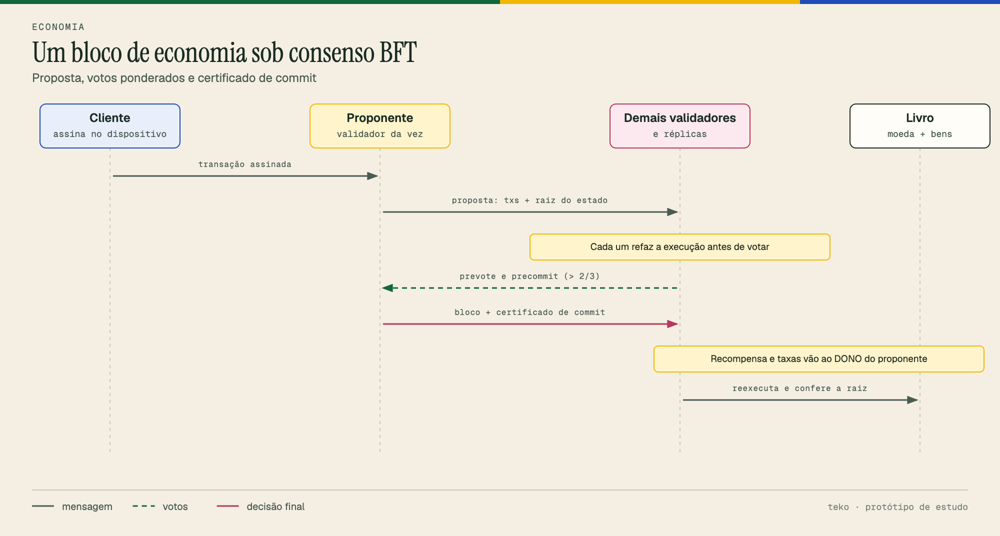

# 7. Livro-razão, blocos e árvore de Merkle

## O que é
Um **livro-razão** (*ledger*) é um registro em que só se **acrescenta**: nada é apagado, tudo é verificável. Ele guarda um **estado** (por exemplo, o saldo de cada endereço) que muda por **transações**. As transações são agrupadas em **blocos**, encadeados por hash.

Peças:
- **Transação (`Tx`):** quem envia (`sender`), para qual módulo (moeda, bens), o conteúdo (`payload`), a **taxa** (`fee`), o **nonce** e a **assinatura** (capítulo 2). Tudo, menos a assinatura, é o que se assina.
- **Nonce:** quantas transações aquele endereço já fez. Só vale a transação com o **próximo** número, o que impede **repetir** (replay) uma transação antiga.
- **Taxa:** paga a quem produz o bloco; fica dentro da transação (assinada) e é cobrada na execução.
- **Bloco:** altura, hash do bloco anterior (`prev_id`), proponente, transações e a **raiz do estado** depois dele.
- **Raiz do estado (`state_root`):** um hash que resume **todo** o estado. Se dois nós executam as mesmas transações, chegam à mesma raiz; se um adultera um saldo, a raiz não bate e o bloco é recusado.
- **Árvore de Merkle:** forma de resumir uma lista em um hash só, de modo que dá para **provar que um item está na lista** mostrando poucos hashes.



> Para **ver** tudo isso na prática, use o [explorador da chain](../flows/15-explorer.md) (`make explorer`).

## Onde ficam taxa e valor na chain
- O **valor** vai no `payload` (por exemplo `Transfer{to, amount}`) e a **taxa** no campo `fee`; ambos dentro da transação assinada, dentro do bloco.
- A **mudança de saldo** é o estado: `charge_fee` debita do remetente e credita ao dono do proponente. O histórico da Suite é reconstruído lendo os blocos.
- Não existe tabela de "taxas pagas": o total do bloco é a soma dos campos `fee`.

## Por que o Teko usa
Qualquer um pode refazer a verificação sem confiar no nó: baixa os blocos, confere certificados (capítulo 6), reexecuta e compara a raiz. O **quadro** de votação (`teko-bulletin`) é um log Merkle append-only: o resultado tem **provas de inclusão**.

## Código
Exemplo de brinquedo (hash fraco; o Teko usa SHA3 com tags distintas para folha e nó) com a **raiz de Merkle** e a regra do **nonce**.

```rust
use std::collections::hash_map::DefaultHasher;
use std::collections::HashMap;
use std::hash::{Hash, Hasher};

// BRINQUEDO: o hash real é SHA3-256 com tag.
fn h(partes: &[&[u8]]) -> u64 {
    let mut s = DefaultHasher::new();
    partes.hash(&mut s);
    s.finish()
}

/// Folha e nó têm "tags" diferentes (0 e 1): um nó nunca pode se passar por folha.
fn folha(dado: &[u8]) -> u64 { h(&[&[0], dado]) }
fn no(a: u64, b: u64) -> u64 { h(&[&[1], &a.to_be_bytes(), &b.to_be_bytes()]) }

fn raiz(dados: &[&[u8]]) -> u64 {
    let mut nivel: Vec<u64> = dados.iter().map(|d| folha(d)).collect();
    while nivel.len() > 1 {
        nivel = nivel
            .chunks(2)
            .map(|p| if p.len() == 2 { no(p[0], p[1]) } else { no(p[0], p[0]) })
            .collect();
    }
    nivel[0]
}

/// Só a transação com o PRÓXIMO nonce do endereço é aceita.
fn aceitar(nonces: &mut HashMap<&'static str, u64>, quem: &'static str, nonce: u64) -> bool {
    let esperado = nonces.entry(quem).or_insert(0);
    if nonce == *esperado { *esperado += 1; true } else { false }
}

fn main() {
    let a = raiz(&[b"tx1", b"tx2", b"tx3"]);
    assert_eq!(a, raiz(&[b"tx1", b"tx2", b"tx3"])); // determinístico
    assert_ne!(a, raiz(&[b"tx1", b"txX", b"tx3"])); // adulterar muda a raiz

    let mut nonces = HashMap::new();
    assert!(aceitar(&mut nonces, "alice", 0));
    assert!(!aceitar(&mut nonces, "alice", 0)); // replay recusado
    assert!(aceitar(&mut nonces, "alice", 1));
    println!("raiz = {a:016x}");
}
```

## Onde está no Teko
- `crates/teko-ledger`: `Tx` (assinada, com `fee` e `nonce`), `Ledger::state_root`, `nonce_of`, módulos.
- `crates/teko-economy`: `EconBlock` (altura, `prev_id`, proponente, `txs`, raiz) e `DecidedBlock` com certificado.
- `crates/teko-bulletin/src/merkle.rs`: `leaf_hash`, `node_hash`, `root`; provas de inclusão.
- Fluxos: [Blocos e validação](../flows/09-blocks-and-validation.md), [Livro-razão](../flows/12-ledger-coin-and-assets.md).

## Cuidados
- O timestamp do bloco é do proponente, **não** é relógio confiável.
- A taxa por byte é 0 na devnet local; o campo `fee` fica zerado.
