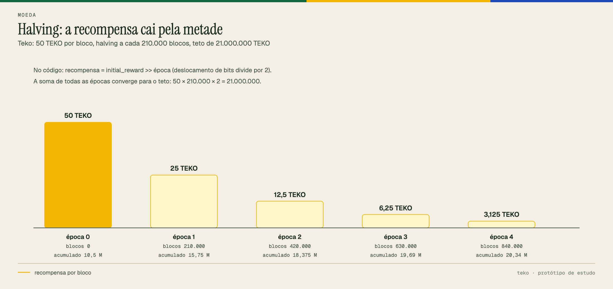
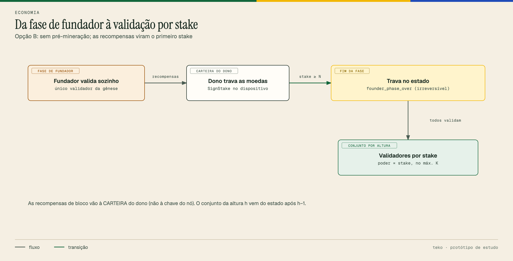

# 8. Moeda: halving, teto, stake e fase de fundador

## O que é
A moeda **TEKO** (menor unidade: **ypy**, capítulo 4) tem **oferta fixa**: um **teto** de 21.000.000 TEKO, e novas moedas só nascem como **recompensa de bloco**.

### Halving
**Halving** ("cortar pela metade") reduz a recompensa à metade a cada intervalo fixo de blocos. No Teko: começa em **50 TEKO** por bloco e cai pela metade a cada **210.000 blocos**: 50, 25, 12,5, 6,25… A soma converge para o teto (50 × 210.000 × 2 = 21 milhões). Efeito: a emissão diminui com o tempo (escassez programada), e o ganho dos validadores migra da moeda nova para as **taxas**. No código é um deslocamento de bits: `initial_reward >> época`.



### Stake
**Stake** é travar moedas como garantia para poder validar blocos. Quem trava ganha **poder de voto** proporcional ao stake; quem trai (equivocação, capítulo 6) perde parte do stake (**slash**, 10% na devnet). Ao pedir saída (*unstake*), as moedas passam por um **período de desvinculação** em que continuam penalizáveis, para que ninguém traia e fuja com o dinheiro.

O poder de voto usado no BFT é quantizado: `poder = max(1, stake × 10.000 / stake_total)`, para o sorteio de proponente não dar sequências enormes ao maior validador.

### Fase de fundador (ADR-0028, opção B)
Sem pré-mineração, quem produz os primeiros blocos? No começo, **só o validador fundador** (da gênese) produz blocos e as **recompensas** vão para a carteira do dono do produto. Ele as **trava como stake**; quando o **stake total** chega a **N**, uma trava no estado (`founder_phase_over`, irreversível) encerra a fase, e os validadores passam a ser os que têm stake. É **centralizado por desenho** nessa fase.



## Código
Std-only: recompensa com halving respeitando o teto, e o poder quantizado.

```rust
const YPY: u64 = 1_000_000; // 1 TEKO
const RECOMPENSA_INICIAL: u64 = 50 * YPY;
const INTERVALO: u64 = 210_000; // blocos por época
const TETO: u64 = 21_000_000 * YPY;

/// Recompensa do bloco `altura`: metade a cada época; nunca passa do teto.
fn recompensa(altura: u64, ja_criado: u64) -> u64 {
    let epoca = altura / INTERVALO;
    let base = if epoca >= 64 { 0 } else { RECOMPENSA_INICIAL >> epoca };
    base.min(TETO - ja_criado) // o teto limita a emissão
}

/// Poder de voto: proporcional ao stake, no mínimo 1.
fn poder(stake: u64, total: u64) -> u64 {
    ((stake as u128 * 10_000 / total as u128) as u64).max(1)
}

fn main() {
    assert_eq!(recompensa(0, 0), 50 * YPY);
    assert_eq!(recompensa(210_000, 0), 25 * YPY);
    assert_eq!(recompensa(420_000, 0), 12_500_000);

    // somando todas as épocas, nunca passa do teto
    let mut criado = 0u64;
    for epoca in 0..64u64 {
        // soma da época inteira de uma vez (210.000 blocos iguais)
        let por_bloco = recompensa(epoca * INTERVALO, criado);
        criado += (por_bloco * INTERVALO).min(TETO - criado);
    }
    assert!(criado <= TETO);
    println!("emitido: {} ypy de {} ypy", criado, TETO);

    assert_eq!(poder(100, 1_000), 1_000); // 10% do stake = 1000 de 10.000
    assert_eq!(poder(1, 1_000_000), 1); // mínimo 1
}
```

## Onde está no Teko
- `crates/teko-coin`: `CoinConfig`, `begin_block` (recompensa, halving, trava da fase), stake, `Unstake`, `slash`.
- `crates/teko-economy/src/genesis.rs`: `test_defaults` (teto, recompensa, halving, N).
- `crates/teko-economy/src/chain.rs`: quantização do poder.
- Fluxo: [Livro-razão, moeda e bens](../flows/12-ledger-coin-and-assets.md); ADRs 0021, 0028 e 0029.

## Cuidados
- Na devnet local o halving quase não acontece (bloco 210.000 leva dias); baixe `halving_interval` no `economy.txt` para ver o efeito.
- O N da devnet local é 1.000 TEKO (cerca de 20 blocos); o padrão documentado de testnet é 1.000.000 TEKO.
