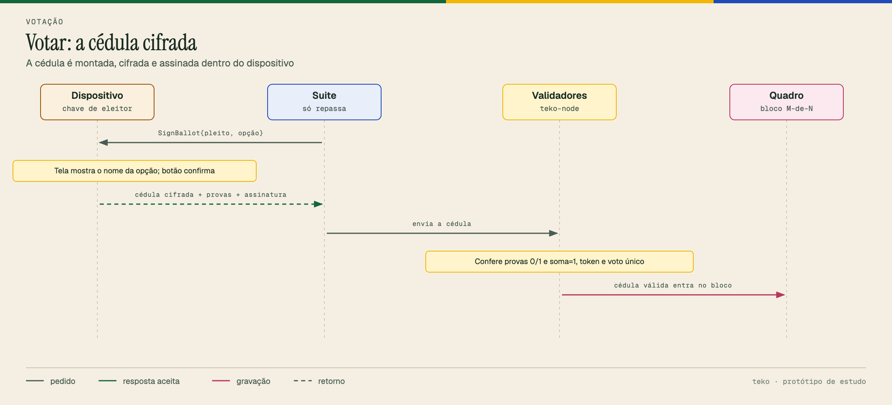
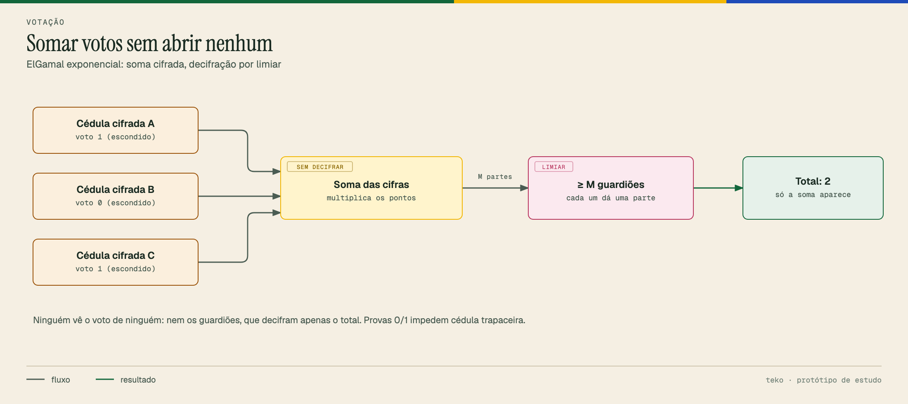
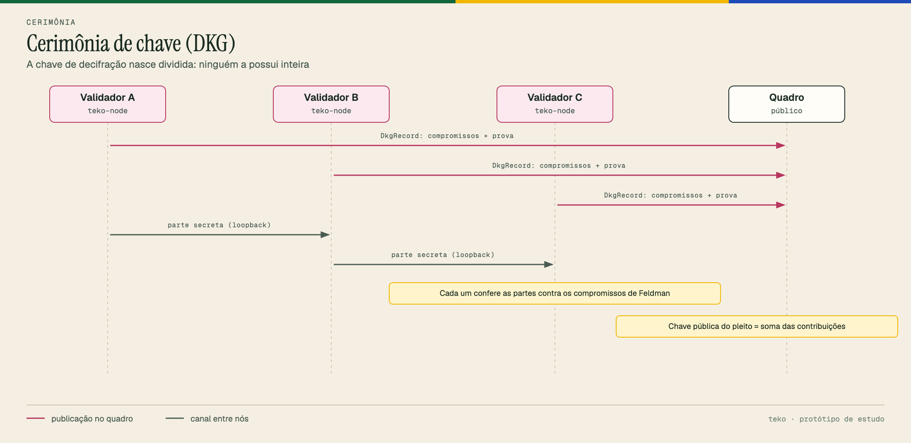
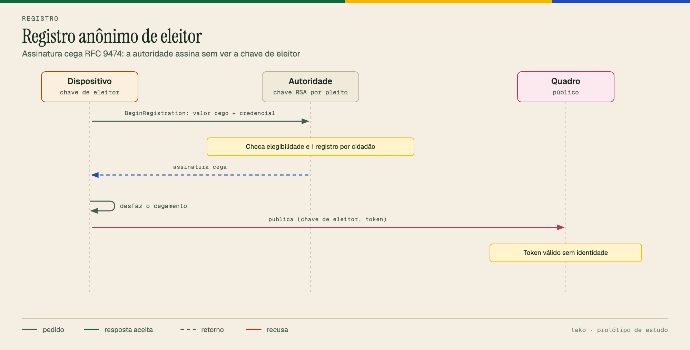

# 9. Votação secreta: ElGamal, limiar, DKG, assinatura cega e nullifier

## O problema
Uma eleição precisa de duas coisas que parecem opostas: **ninguém vê o voto de ninguém** e **qualquer um confere que a soma está certa**. E ainda: só eleitores válidos votam, **uma vez cada**, sem que o voto seja ligado à identidade. O Teko combina cinco ferramentas.



## 9.1 ElGamal exponencial: somar sem abrir
**ElGamal** cifra com a chave pública da eleição. Na versão **exponencial**, o voto `m` (0 ou 1) vai no expoente: `Enc(m) = (g^r, g^m · h^r)`, onde `r` é aleatório e `h` é a chave pública. Multiplicar duas cifras dá uma cifra da **soma** dos votos, sem decifrar nada. Só o **total** é decifrado no fim e, como é pequeno, se acha `m` testando 0, 1, 2…

Uma **prova de conhecimento zero** acompanha cada cédula (provas "é 0 ou 1" e "a soma das opções é 1"), para impedir uma cédula trapaceira (por exemplo, "vale 1000 votos") sem revelar o voto.



## 9.2 Limiar e DKG: ninguém tem a chave inteira
Se uma pessoa tivesse a chave de decifração, ela veria todos os votos. Então a chave é **dividida** entre N validadores (**guardiões**) e só **M juntos** conseguem decifrar o **total** (**limiar**, o que vimos de longe no [capítulo 5](05-m-of-n.md)). Isso é **compartilhamento de segredo de Shamir**: o segredo é o termo constante de um polinômio, e cada guardião recebe um ponto dele; com M pontos se reconstrói, com menos não se aprende nada.

Mas quem divide o segredo no início? Se for uma pessoa, ela o conheceu. A solução é o **DKG** (*distributed key generation*, geração distribuída de chave): **cada validador sorteia o seu próprio polinômio** e as chaves se somam. A chave final existe, mas **nunca esteve inteira em lugar nenhum**. A variante **Feldman** deixa cada um **verificar** as partes recebidas contra **compromissos públicos**, e uma **prova de posse** (Schnorr) impede um participante de escolher a chave para anular as dos outros.



### Código: ElGamal + Feldman + limiar, de brinquedo
Números **minúsculos** e "aleatórios" fixos, só para ver a conta. Um grupo de ordem prima `q` dentro de `Z_p`, com 3 validadores e limiar 2. **Inseguro de propósito.**

```rust
// BRINQUEDO, inseguro: números pequenos e "aleatoriedade" fixa.
const P: u128 = 98_784_247_763; // primo, P = 46*Q + 1
const Q: u128 = 2_147_483_647; // primo: ordem do grupo
const G: u128 = 34_359_770_408; // gerador de ordem Q

fn pot(mut b: u128, mut e: u128, m: u128) -> u128 {
    let mut r = 1;
    b %= m;
    while e > 0 {
        if e & 1 == 1 { r = r * b % m; }
        b = b * b % m;
        e >>= 1;
    }
    r
}
fn inv(a: u128, m: u128) -> u128 { pot(a, m - 2, m) } // inverso modular (m primo)

/// Polinômio secreto de um validador: f(x) = c0 + c1·x (limiar 2).
struct Validador { c: [u128; 2] }
impl Validador {
    fn parte_para(&self, j: u128) -> u128 { (self.c[0] + self.c[1] * j) % Q }
    fn compromissos(&self) -> [u128; 2] { [pot(G, self.c[0], P), pot(G, self.c[1], P)] }
}

/// Feldman: confere a parte recebida SEM conhecer o polinômio: g^parte == C0 · C1^j.
fn feldman_ok(comp: &[u128; 2], j: u128, parte: u128) -> bool {
    pot(G, parte, P) == comp[0] * pot(comp[1], j, P) % P
}

/// Coeficiente de Lagrange em x=0 para recombinar partes de `indices`.
fn lagrange(indices: &[u128], i: u128) -> u128 {
    let (mut num, mut den) = (1u128, 1u128);
    for &j in indices {
        if j != i {
            num = num * j % Q;
            den = den * ((j + Q - i) % Q) % Q;
        }
    }
    num * inv(den, Q) % Q
}

fn main() {
    // --- DKG: cada um sorteia o seu polinômio ---
    let vs = [Validador { c: [11_111, 444] }, Validador { c: [22_222, 555] }, Validador { c: [33_333, 666] }];
    let mut x = [0u128; 3]; // parte de cada guardião na chave final
    for j in 1..=3u128 {
        for v in &vs {
            let parte = v.parte_para(j);
            assert!(feldman_ok(&v.compromissos(), j, parte)); // cada parte é verificável
            x[(j - 1) as usize] = (x[(j - 1) as usize] + parte) % Q;
        }
    }
    // chave pública da eleição: produto dos termos constantes. Ninguém conhece o segredo.
    let h = vs.iter().fold(1u128, |acc, v| acc * v.compromissos()[0] % P);

    // --- três eleitores cifram 1, 0 e 1 ---
    let (votos, r) = ([1u128, 0, 1], [101u128, 202, 303]);
    let (mut c1, mut c2) = (1u128, 1u128);
    for (m, r) in votos.iter().zip(r) {
        let (a, b) = (pot(G, r, P), pot(G, *m, P) * pot(h, r, P) % P); // Enc(m)
        c1 = c1 * a % P; // somar cifras = multiplicar componentes
        c2 = c2 * b % P;
    }

    // --- decifrar o TOTAL com 2 de 3 guardiões (1 e 3) ---
    let quem = [1u128, 3];
    let mut s = 1u128;
    for &j in &quem {
        let parcial = pot(c1, x[(j - 1) as usize], P); // cada um dá a sua parte
        s = s * pot(parcial, lagrange(&quem, j), P) % P;
    }
    let gm = c2 * inv(s, P) % P; // g^total
    let total = (0..=10u128).find(|m| pot(G, *m, P) == gm);
    assert_eq!(total, Some(2));

    // --- com UM guardião só, não sai nada útil ---
    let sozinho = pot(c1, x[0], P);
    let gm_errado = c2 * inv(sozinho, P) % P;
    assert_eq!((0..=1000u128).find(|m| pot(G, *m, P) == gm_errado), None);

    println!("total de votos = {}", total.unwrap());
}
```

## 9.3 Assinatura cega (RFC 9474): votar sem ser rastreado
Para votar, o eleitor precisa provar que **está registrado**, mas o voto não pode ser ligado à identidade. Na **assinatura cega**, o eleitor **esconde** uma mensagem dentro de um "envelope" (cegamento); o órgão de registro assina o envelope **sem ver o conteúdo**; o eleitor remove o envelope e fica com uma **assinatura válida** da mensagem, que o órgão nunca viu. Analogia: papel-carbono dentro de um envelope. O Teko usa **RSA cego** (RFC 9474), com uma chave por pleito.



```rust
// BRINQUEDO: RSA minúsculo, sem preenchimento. O Teko usa RSA de verdade (RFC 9474).
fn pot(mut b: u64, mut e: u64, m: u64) -> u64 {
    let mut r = 1;
    b %= m;
    while e > 0 {
        if e & 1 == 1 { r = r * b % m; }
        b = b * b % m;
        e >>= 1;
    }
    r
}

fn main() {
    let (n, e, d) = (3233u64, 17u64, 2753u64); // chave do órgão (n = 61·53)
    let credencial = 1234u64; // o que o eleitor quer ver assinado
    let r = 7u64; // fator de cegamento secreto do eleitor

    let cegada = credencial * pot(r, e, n) % n; // 1) eleitor esconde
    let assinada_cega = pot(cegada, d, n); // 2) órgão assina SEM ver `credencial`
    let r_inv = pot(r, 3119, n); // inverso de r mod n: r^(φ(n)-1), com φ(n) = 60·52 = 3120
    let assinatura = assinada_cega * r_inv % n; // 3) eleitor remove o cegamento

    assert_eq!(pot(assinatura, e, n), credencial); // vale como assinatura do órgão
    assert_ne!(cegada, credencial); // o órgão só viu o envelope
    println!("assinatura válida sobre uma mensagem que o órgão nunca viu");
}
```

## 9.4 Commitment e nullifier: um voto por eleitor
- **Commitment `C`**: "compromisso" com um segredo do eleitor, `C = H(s)`. Registra-se `C`, que não revela `s`.
- **Nullifier `N`**: valor derivado de `s` **e da eleição**, `N = H(s, eleição)`. Ao votar, o eleitor mostra `N`. Votou de novo? Sai o **mesmo** `N`, e o duplo voto é detectado. Em outra eleição o `N` é outro e **não dá para correlacionar**.

```rust
// BRINQUEDO: o hash real é SHA3-256 com tag (e, no futuro, Poseidon para ZK).
use std::collections::hash_map::DefaultHasher;
use std::collections::HashSet;
use std::hash::{Hash, Hasher};

fn h(partes: &[&str]) -> u64 {
    let mut s = DefaultHasher::new();
    partes.hash(&mut s);
    s.finish()
}

fn main() {
    let segredo = "segredo-do-eleitor";
    let compromisso = h(&["commitment", segredo]); // C: publicado, sem revelar `s`

    let n_2026 = h(&["nullifier", segredo, "eleicao-2026"]);
    let n_2028 = h(&["nullifier", segredo, "eleicao-2028"]);
    assert_ne!(n_2026, n_2028); // eleições diferentes: nullifiers não se correlacionam

    let mut usados = HashSet::new();
    assert!(usados.insert(n_2026)); // 1º voto: aceito
    assert!(!usados.insert(n_2026)); // 2º voto na mesma eleição: recusado
    println!("C = {compromisso:016x}");
}
```

## Onde está no Teko
- `crates/teko-ballot-crypto`: `elgamal.rs` (cifra, `combine_shares`, `lagrange_at_zero`), `proofs.rs` (prova 0/1, soma, decifração), `dkg.rs` (Feldman + prova de posse), `ballot.rs` (cédula cifrada e soma). Curva **P-256**.
- `crates/teko-registration`: RSA cego RFC 9474 (`rsa` 0.10, validado contra os vetores do RFC).
- `crates/teko-crypto/src/voter.rs`: commitment e nullifier (hoje com SHA3; **Poseidon e prova ZK são stubs**).
- Fluxos: [Votação cifrada](../flows/05-encrypted-voting.md), [Registro anônimo](../flows/04-anonymous-registration.md), [Cerimônia de chave](../flows/08-key-ceremony.md), [Apuração](../flows/07-tally-and-results.md). ADRs 0008 e 0019.

## Cuidados
- **Sem auditoria.** Cripto própria de votação é o tipo de código que precisa de revisão externa antes de qualquer uso real.
- O DKG tem um limite conhecido e aceito (como o de Helios e Belenios): um adversário ativo pode **enviesar** a distribuição da chave pública, não aprender nem escolher o segredo.
- As partes secretas do DKG precisam de canal autenticado e cifrado; na rede local de teste é loopback.
- A prova ZK de pertencimento ao registro (nullifier) ainda não existe: é um stub.
