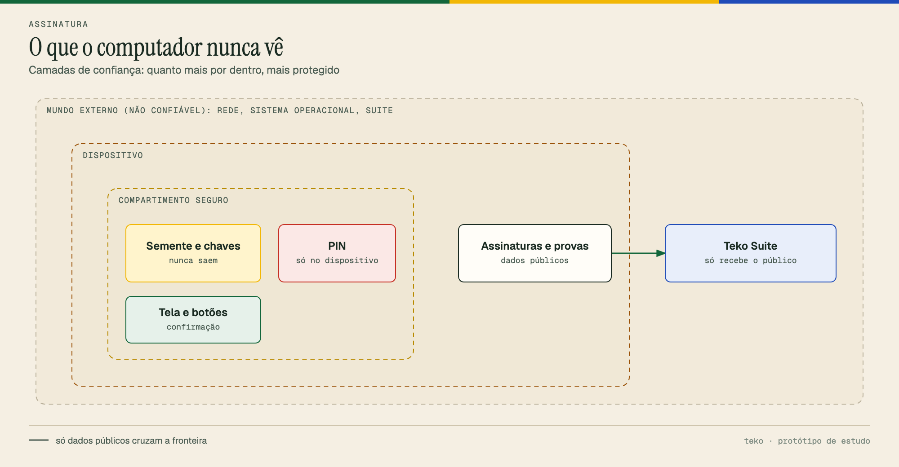
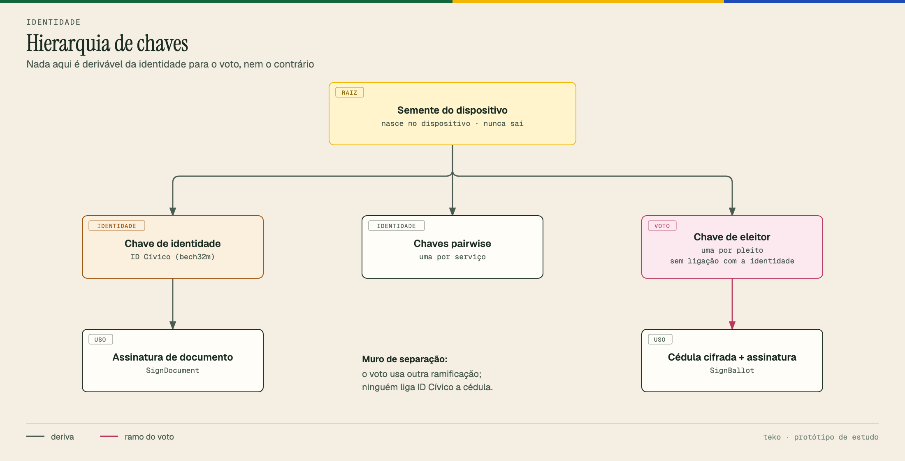

# 10. Segurança do dispositivo

## O que é
O Teko parte de uma regra: **o computador não é confiável**. Ele pode ter vírus, extensão maliciosa ou um aplicativo comprometido. Por isso, tudo o que é sensível acontece no **dispositivo** (hoje um emulador), e a Suite só repassa dados públicos.

## As defesas
1. **PIN só no dispositivo.** Nenhuma mensagem do protocolo carrega PIN, e a Suite não tem campo de PIN. O PIN é conferido em **tempo constante** (para o tempo de resposta não revelar quantos dígitos estavam certos) e, depois de **N erros**, o dispositivo se **apaga** (*wipe*).
2. **O que você vê é o que é assinado.** A transação, a cédula ou o documento são montados **dentro do dispositivo** a partir do que ele mostra na tela, e a assinatura só sai depois do botão físico. Uma Suite comprometida não consegue trocar o destino ou o valor.
3. **Segredos são limpos da memória.** Tipos de segredo não implementam `Debug` nem `Serialize` e usam `zeroize` ao serem descartados.
4. **Firmware M-de-N e anti-downgrade** ([capítulo 5](05-m-of-n.md)): só roda código assinado por várias instituições, e versões antigas são recusadas.
5. **Atestação sem rastreamento.** O dispositivo prova que é genuíno com **chaves de lote**, compartilhadas por muitos aparelhos, e a atestação nunca acompanha um voto.
6. **Separação identidade ↔ voto.** O segredo de eleitor não é derivável da identidade (nem o contrário), e as chaves nascem de rótulos diferentes ([capítulo 1](01-hash.md)): `teko/v1/identity` e `teko/v1/voter` não se misturam.





## Código
Std-only: comparação em tempo constante, contador de PIN com apagamento e limpeza de segredo ao descartar.

```rust
/// Compara sem parar no primeiro byte diferente: o tempo não depende de onde erra.
/// (O Teko usa o crate `subtle` para isso.)
fn igual_tempo_constante(a: &[u8], b: &[u8]) -> bool {
    if a.len() != b.len() { return false; }
    let mut diferenca = 0u8;
    for (x, y) in a.iter().zip(b) {
        diferenca |= x ^ y; // acumula, sem desvio por byte
    }
    diferenca == 0
}

#[derive(Debug, PartialEq)]
enum Resultado { Aberto, Errado(u32), Apagado }

struct Pin { correto: Vec<u8>, erros: u32, maximo: u32 }
impl Pin {
    fn tentar(&mut self, digitado: &[u8]) -> Resultado {
        if igual_tempo_constante(&self.correto, digitado) {
            self.erros = 0;
            return Resultado::Aberto;
        }
        self.erros += 1;
        if self.erros >= self.maximo {
            // apaga o segredo: sem volta
            self.correto.iter_mut().for_each(|b| *b = 0);
            return Resultado::Apagado;
        }
        Resultado::Errado(self.maximo - self.erros)
    }
}

/// Segredo que zera a própria memória ao ser descartado (o Teko usa `zeroize`).
struct Segredo([u8; 4]);
impl Drop for Segredo {
    fn drop(&mut self) {
        for b in self.0.iter_mut() {
            // escrita "volátil": o compilador não pode otimizar fora
            unsafe { std::ptr::write_volatile(b, 0) };
        }
    }
}

fn main() {
    assert!(igual_tempo_constante(b"482913", b"482913"));
    assert!(!igual_tempo_constante(b"482913", b"482914"));

    let mut pin = Pin { correto: b"482913".to_vec(), erros: 0, maximo: 3 };
    assert_eq!(pin.tentar(b"000000"), Resultado::Errado(2));
    assert_eq!(pin.tentar(b"111111"), Resultado::Errado(1));
    assert_eq!(pin.tentar(b"222222"), Resultado::Apagado); // 3 erros: wipe
    // depois de apagado, nem o PIN certo abre: o segredo foi zerado
    assert_eq!(pin.tentar(b"482913"), Resultado::Apagado);

    let _s = Segredo([1, 2, 3, 4]); // ao sair do escopo, vira zeros
}

```

## Onde está no Teko
- `crates/teko-device-core`: máquina de estados, PIN (`max_pin_attempts`, `subtle`), wipe, confirmação física antes de assinar.
- `crates/teko-attestation`: manifestos de firmware M-de-N, cadeias de atestação por chave de lote.
- `docs/KEY-HIERARCHY.md`, `docs/THREAT-MODEL.md`, `docs/TEST-MATRIX.md` (cada invariante liga a um teste).
- Fluxos: [Identidade e dispositivo](../flows/01-identity-and-device.md).

## Cuidados
- O **emulador** não tem isolamento de hardware: a frase da carteira e o PIN passam por um terminal comum. As garantias acima valem para o **desenho**; hardware real é fase futura.
- Botões automáticos existem só sob a feature de teste (`test-buttons`), nunca no build normal; o `release-check` confere.
