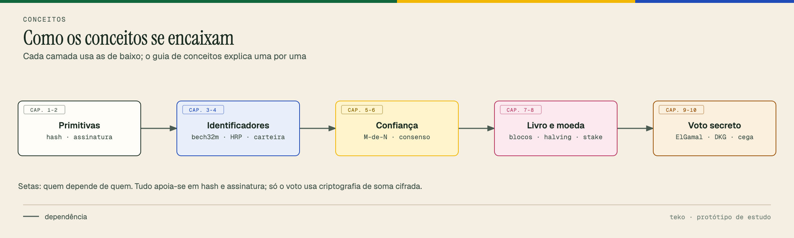

# Guia de conceitos do Teko

Este guia explica, em português e com exemplos em Rust, as ideias que o Teko usa: hash, assinatura, endereços (HRP), carteira, M-de-N, consenso (PoA e BFT), livro-razão, moeda (halving), votação secreta (ElGamal, DKG) e a segurança do dispositivo. O [glossário](../GLOSSARY.md) é a consulta rápida; aqui é onde se aprende.

## Como ler
Cada capítulo segue o mesmo molde: **o que é** (com analogia), **por que o Teko usa**, **diagrama**, **código Rust simples**, **onde está no Teko** e **cuidados**. Os códigos são didáticos: rodam sozinhos (`rustc arquivo.rs`) e, quando usam números pequenos ou funções de mentira, **dizem isso no próprio bloco**. Nunca copie um exemplo de brinquedo para produção; o código de verdade está nos crates indicados.

## Capítulos
| Capítulo | O que você aprende |
|---|---|
| [1. Hash e hash com tag](01-hash.md) | Impressão digital, SHA3, separação de domínio |
| [2. Chaves e assinaturas](02-signatures.md) | Chave privada/pública, ECDSA P-256, assinar e verificar |
| [3. Endereços e HRP (bech32m)](03-addresses-bech32m.md) | Prefixo legível, checksum, `teko`/`tekow`/`tekop` |
| [4. Carteira: frase, derivação e TEKO/ypy](04-wallet.md) | BIP-39, SLIP-10, caminho `m/7240'/…`, casas decimais |
| [5. M-de-N](05-m-of-n.md) | Limiar de assinaturas: firmware, blocos PoA, bens |
| [6. Consenso: PoA e BFT](06-consensus.md) | Qual algoritmo usamos, quórum > 2/3, rodadas, lock, slash |
| [7. Livro-razão, blocos e Merkle](07-ledger.md) | Transação, nonce, taxa, raiz de estado, quadro |
| [8. Moeda: halving, stake e fundador](08-coin.md) | Recompensa, teto, poder de voto |
| [9. Votação secreta](09-voting-crypto.md) | ElGamal exponencial, limiar, DKG, assinatura cega, nullifier |
| [10. Segurança do dispositivo](10-device-security.md) | PIN, `zeroize`, atestação, separação identidade ↔ voto |

## Resposta curta às perguntas mais comuns
- **Que consenso usamos?** Dois: **PoA M-de-N** no livro de votos (hoje) e **BFT estilo Tendermint ponderado por stake** no livro de economia. [Capítulo 6](06-consensus.md).
- **Que criptografia?** SHA3-256 (hash), ECDSA sobre P-256 (assinatura), ElGamal exponencial de limiar em P-256 (cédula), RSA cego RFC 9474 (registro anônimo), bech32m (endereços). Tudo é "sem auditoria" nesta fase.
- **Que assinatura?** ECDSA P-256 com hash com tag (capítulo 2); M-de-N para o que exige várias instituições (capítulo 5).

*Aviso:* é um projeto de estudo. Nenhuma parte foi auditada.
