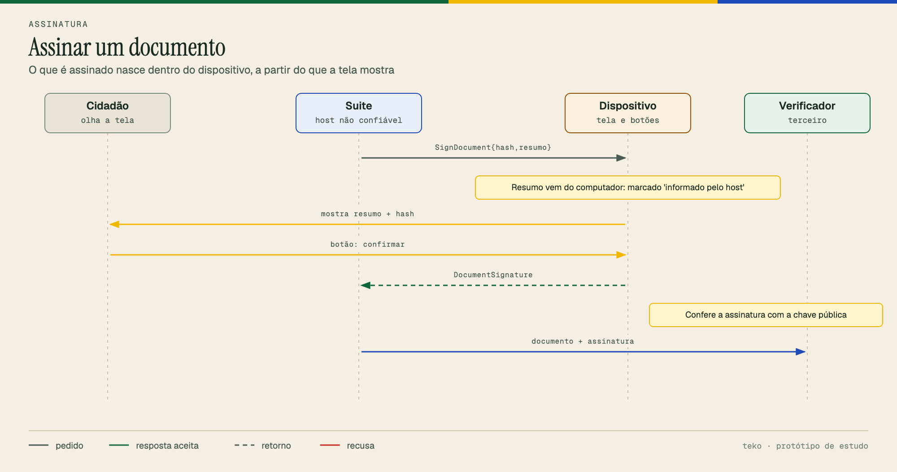
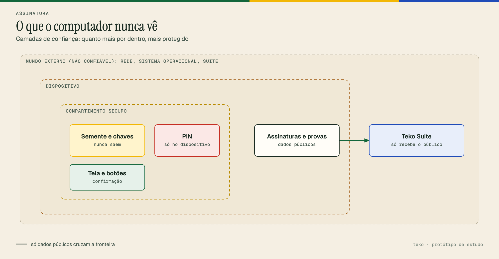

# Assinatura

← [Índice da documentação](../README.md)

## Resumo
Quando você assina um documento (ou uma cédula), o que vale é o que o **dispositivo** mostra e confirma. A Suite pode mentir sobre o resumo, mas não consegue assinar nada sem o seu botão, nem ver a chave.

## Quem participa
Cidadão, Suite, dispositivo e quem verifica a assinatura.

## Diagramas

## Passo a passo
1. A Suite envia `SignDocument{hash, resumo}`.
2. O dispositivo mostra o resumo (marcado como "informado pelo computador") e o **hash**.
3. O cidadão confirma no botão.
4. O dispositivo devolve `DocumentSignature`; a chave privada nunca sai.
5. Quem recebe confere a assinatura com a chave pública.

## O que é verificado e por quem
O dispositivo só assina após confirmação física. O verificador usa apenas a chave pública.

## O que pode dar errado
Resumo enganoso: por isso o hash também aparece. Recusa no botão (`UserRejected`) ou tempo esgotado (`Timeout`).

## Onde está no código
`crates/teko-device-core/src/device.rs`, `crates/teko-crypto/src/sign.rs`, `crates/teko-client/src/signed_doc.rs`.

## Testes que cobrem
Proptest "assinatura só sai depois da confirmação" e "nenhuma mensagem expõe chave privada ou PIN" ([TEST-MATRIX](../TEST-MATRIX.md)).

## Limites honestos
Sem validade jurídica (ICP-Brasil está fora de escopo).
