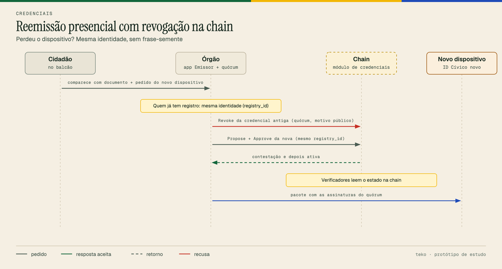

# Credencial cívica e reemissão

← [Índice da documentação](../README.md)

## Resumo
A **credencial cívica** liga seus atributos (nome, nascimento, domicílio eleitoral…) à sua **chave de identidade**. Ela é emitida por um **órgão** (quórum M-de-N, no app **Teko Emissor**), fica **registrada na chain** e passa por uma janela de contestação antes de valer ([ADR-0038](../adr/0038-id-civico-como-credencial-na-chain.md)). Se o dispositivo for perdido, o órgão **revoga na chain** a credencial antiga e emite uma nova, com o **mesmo `registry_id`** e **sem frase-semente**.

## Quem participa
Cidadão (Suite e dispositivo), membros do órgão (cada um com o próprio dispositivo), chain de economia, novo dispositivo.

## Diagramas

## Passo a passo
1. **Pedido:** o dispositivo prova que tem a chave de identidade e é genuíno (`GetIdentityRequest`); a Suite o entrega ao órgão.
2. **Emissão:** um membro propõe (atributos que o órgão verificou) e os demais aprovam, cada um assinando **no próprio dispositivo**. A chain guarda só um **compromisso** com resumos salgados por atributo.
3. **Contestação e validade:** o quórum pode vetar na janela; depois a credencial fica ativa até `valid_until`.
4. **Pacote:** o órgão entrega ao titular os atributos, o sal e as transações assinadas (tiradas da chain). O dispositivo confere **sozinho** compromisso, id e **M membros distintos** do órgão que o `trust.txt` lista.
5. **Perda do dispositivo:** o órgão **revoga** a credencial antiga (quórum, motivo público) e emite a nova com o mesmo `registry_id`. Quem lê a chain deixa de aceitar a antiga.

## O que é verificado e por quem
- **Dispositivo:** o pacote (assinaturas do quórum, compromisso, titular = a própria chave).
- **Quem usa a credencial** (a Suite, o registro de voto): o estado na **chain** (ativa, não vetada, não revogada, não expirada) e a apresentação assinada pela chave de identidade. A prova de idade revela só `age_over_18` e os resumos dos demais atributos.
- O registro de eleitor ocorre **uma vez por cidadão por pleito**, mesmo após reemissão (o cidadão é o `registry_id`).

## O que pode dar errado
Membros do órgão emitem algo falso (o livro prova **quem** emitiu, não a verdade). O dispositivo não vê veto nem revogação (a credencial continua instalada, mas deixa de valer para quem lê a chain). A chain não impede duas identidades de chaves diferentes: o órgão deduplica por `registry_id`.

## Onde está no código
`crates/teko-crypto/src/civic.rs` (pacote, compromisso, apresentação), `crates/teko-credentials` (módulo e atributos), `crates/teko-device-core` (instalar e provar), `crates/teko-client` (`verify_identity_request`, `prove_attribute`), `apps/issuer` (emitir e entregar), `apps/suite` (pedir e instalar), `tools/issuer-cli` (`sign_registration`). Decisão: [ADR-0038](../adr/0038-id-civico-como-credencial-na-chain.md); processo: [RECOVERY](../RECOVERY.md).

## Testes que cobrem
`crates/teko-crypto/src/civic.rs` (testes do pacote), `crates/teko-device-core/src/tests.rs`, `crates/teko-client/tests/e2e.rs` (emissão, prova contra a chain, registro e reemissão), `tools/devnet-sim/tests/e2e.rs`. Ver [TEST-MATRIX](../TEST-MATRIX.md).

## Limites honestos
Por escolha, a **identidade** não tem seed/mnemônico: a recuperação depende do órgão. (A **carteira** tem frase de recuperação própria e independente: [fluxo 14](14-wallet-and-seed.md).) O operador de teste só existe com a feature `dev-simulation`. Sem validade jurídica.
