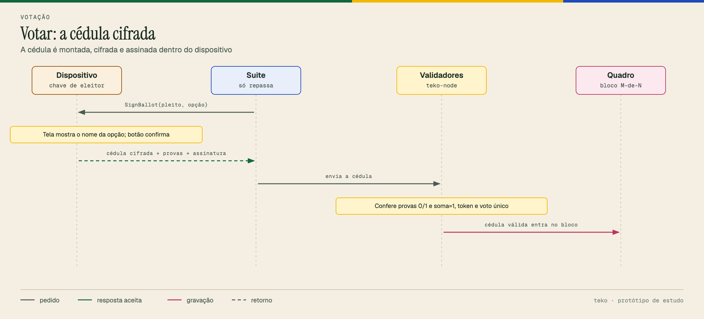
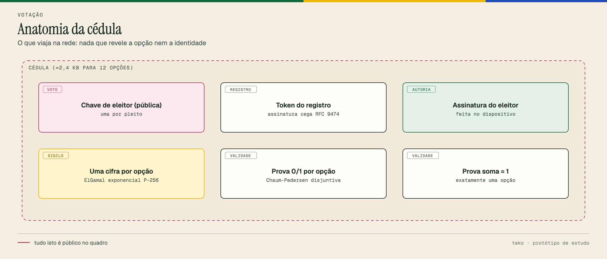
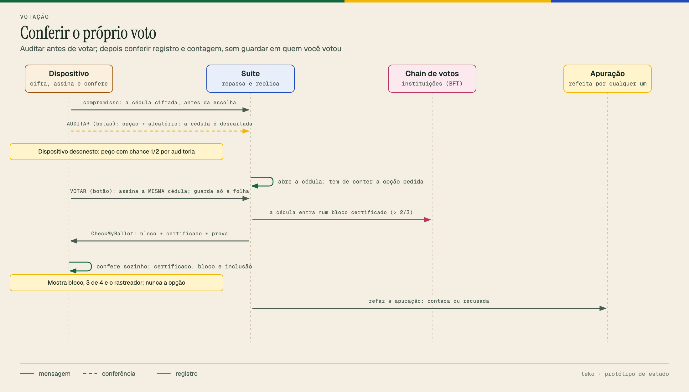

# Votação cifrada

← [Índice da documentação](../README.md)

## Resumo
A cédula é montada **no dispositivo**: uma cifra por opção (ElGamal exponencial sobre P-256) mais provas de que há exatamente uma opção marcada. Na rede ninguém vê o voto; os validadores só conferem que a cédula é **válida**.

## Quem participa
Dispositivo, Suite, validadores, quadro (blocos).

## Diagramas

## Passo a passo
1. A Suite envia `SignBallot{pleito, opção}`; a tela mostra o **nome da opção** (vindo do manifesto) e pede confirmação.
2. O dispositivo cifra cada posição, gera as provas (0 ou 1 por opção; soma = 1) e **se compromete** com a cédula: o computador a recebe **antes** da escolha (ADR-0041).
3. No dispositivo, o eleitor escolhe: **votar** (assina a mesma cédula com a chave de eleitor do pleito; o aleatório é apagado; ficam só `contest_hash` e a folha Merkle) ou **auditar** (o dispositivo revela opção e aleatório **desta** cédula, que é descartada; o computador a abre e exige a opção pedida). Auditar não consome o voto.
4. A Suite repassa a cédula votada ao nó, que confere provas, token do registro, assinatura e **voto único**; se válida, entra no próximo bloco.
5. **Conferir minha cédula:** a Suite acha o bloco certificado e a prova Merkle e envia `CheckMyBallot`; o dispositivo confere **sozinho** certificado (> 2/3 das instituições do `trust.txt`), bloco e inclusão da sua folha, e mostra bloco, "k de N" e o rastreador. A Suite mostra também o veredito da apuração para a própria cédula.

## O que é verificado e por quem
O dispositivo: a própria cédula (auditoria), o certificado e a inclusão (conferência). O computador: que a cédula auditada contém a opção pedida. Todos os validadores: provas de conhecimento zero (Chaum-Pedersen com Fiat-Shamir forte, ligado a eleição, pleito, posição e chave), token e unicidade.

## O que pode dar errado
Cédula com duas opções ou nenhuma (prova inválida), eleitor não registrado, voto repetido, votar após o prazo (o dispositivo recusa e `close-due` fecha).

## Onde está no código
Auditoria e conferência: `encrypt_ballot_with`/`open_ballot` (`teko-ballot-crypto`), `sign_ballot` e `check_my_ballot` (`teko-device-core`), `sign_ballot_or_audit`/`check_my_ballot` (`teko-client`), `Chain::inclusion_evidence` (`teko-chain`), `Tallier::watch_ballot` (`teko-election`), `election_check_ballot` (Suite). Decisão: [ADR-0041](../adr/0041-conferir-o-proprio-voto.md).
`crates/teko-ballot-crypto` (`elgamal.rs`, `proofs.rs`, `ballot.rs`), `crates/teko-election/src/ballot.rs`, `tools/teko-node`. Decisão: [ADR-0019](../adr/0019-cedulas-cifradas-elgamal-de-limiar.md).

## Testes que cobrem
Unit e proptest em `teko-ballot-crypto`; `tools/teko-node/tests/network.rs`. Medido: 12 opções ≈ 2,4 kB, ~22 ms para cifrar, ~18 ms para verificar.

## Limites honestos
Auditar dá garantia **estatística** (chance ½ por auditoria contra um dispositivo desonesto) e não existe "ver depois em quem votei": é de propósito, para não haver recibo. A contagem é conferida pela Suite, não pelo dispositivo. Sem prova ZK de elegibilidade nem *nullifier* (o voto único é checado pela chave de eleitor). Criptografia própria, sem auditoria. Risco "colher agora, decifrar depois" contra computação quântica.
