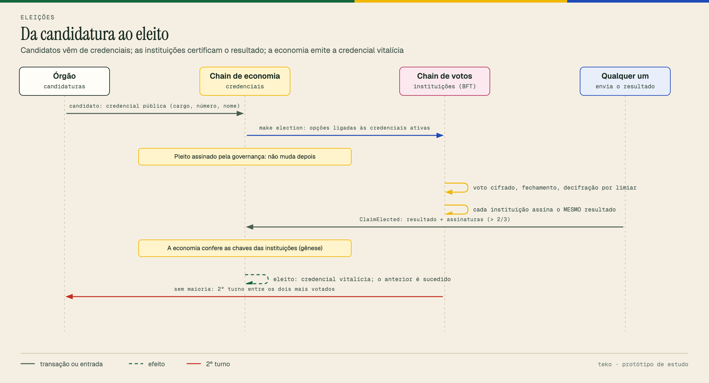
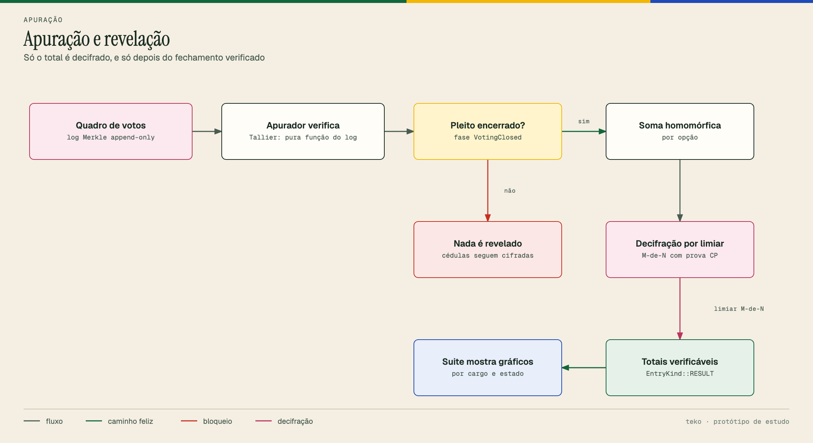
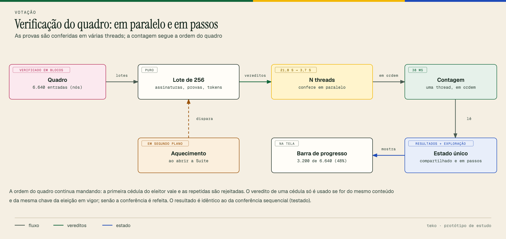

# Apuração e resultados

← [Índice da documentação](../README.md)

## Resumo
Enquanto a votação está aberta **nada é mostrado**. Depois do fechamento, as cédulas são somadas **ainda cifradas** e só o **total por opção** é decifrado, por limiar (M-de-N validadores). A Suite mostra gráficos por cargo e estado.

## Quem participa
Quadro, apurador (`Tallier`), validadores com suas partes da chave, Suite.

## Diagramas

## Passo a passo
1. `make close` (ou o prazo) encerra os pleitos.
2. O `Tallier`, função pura do log, verifica cada entrada.
3. Soma homomórfica por opção.
4. Cada validador publica sua ação de decifração com prova (`EntryKind::RESULT`); com M delas o total é combinado.
5. Quem quiser refaz a conta: `make tally` ou a Suite (aba **Resultados**).

## O que é verificado e por quem
Qualquer um confere as provas das ações de decifração contra a chave pública da cerimônia. O serviço de resultado do nó só responde **depois do fechamento verificado**.

## O que pode dar errado
M validadores em conluio poderiam abrir **antes** do prazo. Resultado desatualizado na Suite foi corrigido: o cache é amarrado à primeira entrada do quadro.

## Verificação em paralelo, em passos e com progresso

Conferir cada cédula (assinatura e provas ElGamal) e cada token de registro custa ~3 ms; num quadro de 6.640 entradas isso eram **21,8 s** em uma thread. Agora o `election-admin-cli` confere as entradas em **lotes de 256, em várias threads**, e depois **conta uma a uma, na ordem do quadro** (a primeira cédula do eleitor vale, as repetidas são rejeitadas): **3,7 s** com 11 núcleos, com resultado idêntico ao sequencial. O veredito de uma cédula só é usado se for do mesmo conteúdo e da mesma chave da eleição; senão a conferência é refeita ([ADR-0033](../adr/0033-verificacao-do-quadro-em-paralelo-e-em-passos.md)).

Na Suite, Resultados ao vivo e Exploração pública compartilham **um só apurador**, avançado **em passos** e mantido em dia por uma thread de fundo desde que a Suite abre; as telas mostram "Verificando o quadro: X de Y" com os números do trecho já verificado. `make tally-time` mostra o tempo na apuração (`TEKO_VERIFY_THREADS` e `TEKO_VERIFY_TRACE`).

## Onde está no código
`crates/teko-election/src/tally.rs`, `result.rs`, `crates/teko-ballot-crypto`, `tools/teko-node`.

## Testes que cobrem
Testes de apuração em `teko-election`, `tools/election-admin-cli/tests`, simulador de eleitores (`make simulate`).

## Limites honestos
Dados simulados sempre rotulados. A privacidade perante M validadores desonestos depende da confiança no limiar.

## Resultado certificado e o eleito (ADR-0040)
Depois da decifração, cada instituição calcula o **resultado** do pleito com uma regra pura (maioria absoluta **dos votos em candidatos** no 1º turno, com **branco e nulo contados e mostrados, mas fora da base**, ADR-0042; senão 2º turno entre os dois mais votados; empate sem decisão automática = **sem eleito**, PENDENTE), **assina** e publica no quadro (`OUTCOME`). `make claim` leva à economia os resultados assinados por **mais de 2/3** das instituições; o eleito recebe a credencial **vitalícia** `eleito` e o anterior do mesmo cargo e jurisdição é **sucedido**. Só cargos de vaga única (Presidente, Governador, Prefeito); `election-admin outcomes` mostra quantas instituições assinaram.

