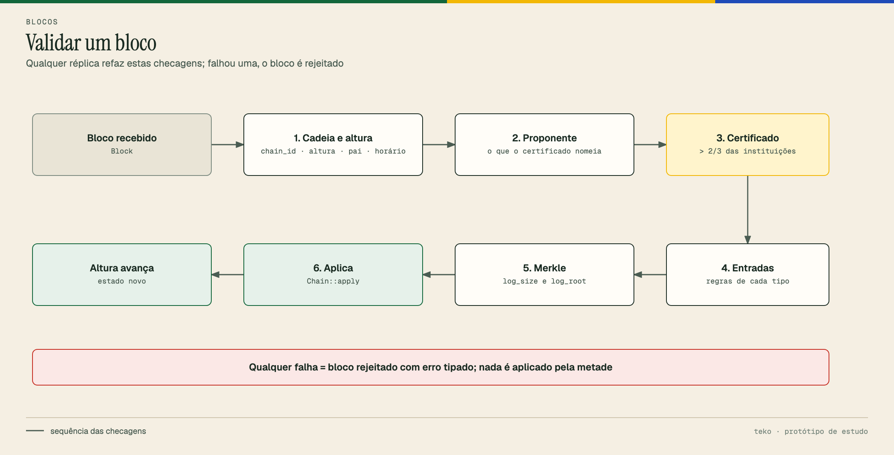

# Blocos e validação

← [Índice da documentação](../README.md)

## Resumo
Um bloco agrupa entradas (manifesto, registros, cédulas, DKG, resultados) e é final só com o **certificado de commit** (mais de 2/3 das instituições, BFT, ADR-0034). Qualquer réplica refaz a validação inteira antes de aplicar.

## Quem participa
Proponente, validadores e réplicas (`Chain::apply`).

## Diagramas

## Passo a passo
Um bloco carrega `chain_id`, `height` (a partir de 1), `prev_hash`, `timestamp`, `proposer`, `entries`, `log_size` e `log_root`; a rede decide o bloco e o **certificado de commit** (precommits de mais de 2/3 das instituições, com a rodada).
1. Confere cadeia, altura e `prev_hash`.
2. Confere se o proponente é o que o certificado nomeia (sorteado pelo motor para aquela altura e rodada) e se o horário só avança.
3. Confere o certificado: precommits distintos, válidos, de instituições do genesis, para este bloco, altura e rodada, somando mais de 2/3.
4. Valida cada entrada pelas regras do seu tipo.
5. Recalcula tamanho e raiz Merkle do log.
6. Aplica e avança a altura.

## O que é verificado e por quem
Todas as réplicas e todo cliente que sincroniza. Dois votos assinados em conflito pela mesma instituição são **equívoco** (evidência contada e mostrada no status).

## O que pode dar errado
Bloco forjado, fork, proponente fora de turno, entrada inválida: o bloco é rejeitado com erro tipado.

## Onde está no código
`crates/teko-chain` (`block.rs`, `chain.rs`, `profile.rs`), `crates/teko-bulletin` (Merkle).

## Testes que cobrem
Testes de `teko-chain` e `tools/teko-node/tests/network.rs`.

## Limites honestos
Perfis: `devnet` e `testnet` existem; **mainnet está travada**. Esta é a rede PoA federada; o consenso BFT ([fluxo 11](11-bft-consensus.md)) ainda não está integrado ao nó.
