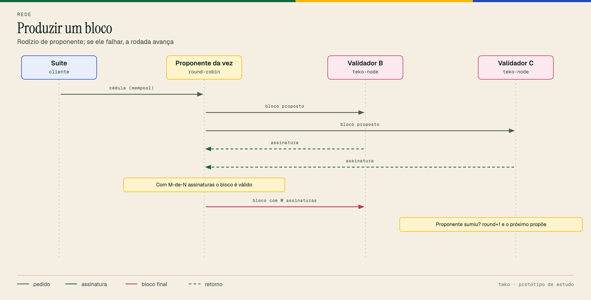
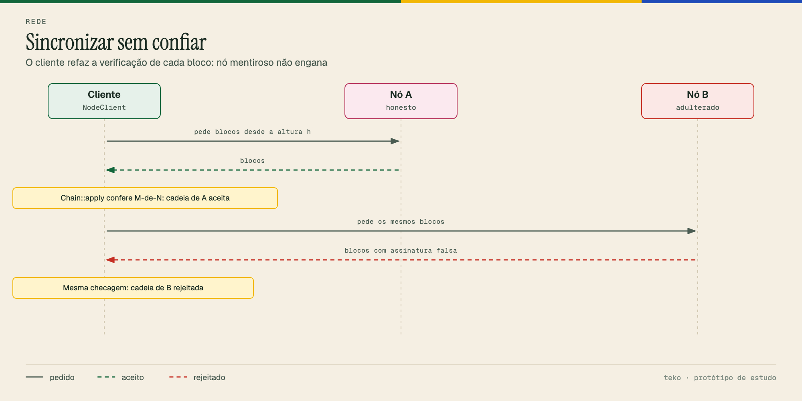
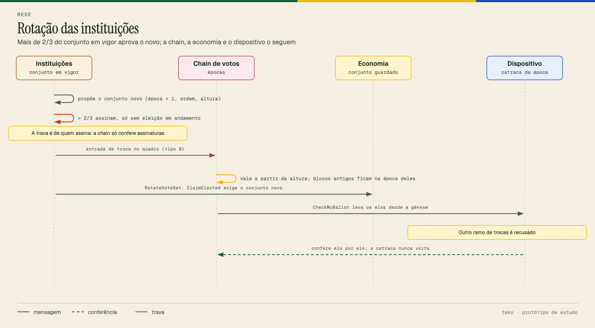

# Rede e sincronização

← [Índice da documentação](../README.md)

## Resumo
Os validadores (`teko-node`) trocam entradas, transações e votos do consenso por *gossip* TCP e decidem os blocos por **BFT** (ADR-0034): o proponente é sorteado por rodada e, se falhar, a rodada seguinte tem outro. **Nenhum bloco nasce sozinho.** Clientes (Suite, `election-admin`, verificador) **não confiam em nenhum nó**: baixam os blocos e refazem a verificação.

## Quem participa
Suite ou cliente, proponente da rodada, demais instituições.

## Diagramas

## Passo a passo
1. A entrada (ou transação) chega ao *mempool* de um nó, que a espalha aos pares. Só então a altura começa (após um curto intervalo que agrupa uma rajada); com tudo parado a cadeia fica parada.
2. O proponente sorteado monta o bloco; as instituições dão prevote e precommit; com mais de 2/3 de precommits o bloco é final e o **certificado de commit** vai junto.
3. Se o proponente não responde ou censura, estoura o *timeout* e a rodada seguinte tem outro proponente. Sem quórum a rede pausa, nunca bifurca.
4. O cliente usa `NodeClient::sync_chain` / `sync_into` e aplica cada bloco por `Chain::apply`.

## Como operar (make)
`make devnet` → `make devnet-dkg` → `make devnet-status` / `make devnet-blocks` → `make devnet-stop`. Limpeza: `make devnet-reset`. Detalhes: [NETWORKS](../NETWORKS.md).

## O que é verificado e por quem
O cliente verifica toda a cadeia (certificado, proponente, encadeamento, raiz Merkle); nó com certificado falso é descartado.

## O que pode dar errado
Nós órfãos de uma execução antiga ("Address already in use"): `make devnet-stop` encerra os órfãos. Com 3 instituições, um nó fora do ar **pausa** a rede (não há quórum): use 4 para tolerar 1. Redes criadas antes do ADR-0034 (`blocks.log`) precisam de `make devnet-reset`.

## Onde está no código
`tools/teko-node` (`node.rs`, `client.rs`, `wire.rs`), `crates/teko-chain`.

## Testes que cobrem
`tools/teko-node/tests/network.rs` (portas alocadas globalmente para não colidir).

## Limites honestos
PoA federada, não finalidade bizantina. Sem rede entre máquinas ainda.

## Rotação das instituições (ADR-0045)
O conjunto de instituições deixa de ser fixo: uma **troca** (época + 1, conjunto novo **ordenado**, altura em que vale, o conjunto que substitui) aprovada por **mais de 2/3 do conjunto em vigor** entra no quadro como entrada do tipo 9 e vale a partir da altura marcada. A `Chain` guarda épocas: cada bloco é conferido contra o conjunto da **sua** altura (inclusive o proponente do consenso), então blocos antigos continuam válidos e qualquer réplica refaz as épocas desde a gênese. A economia recebe a mesma troca (`RotateVoteSet`) e `ClaimElected` passa a exigir o conjunto novo; a cerimônia de chave seguinte é entre as instituições em vigor, com uma sessão que nomeia a época; o dispositivo segue as trocas elo por elo (`CheckMyBallot.rotations`) e guarda uma **catraca** de época. A regra "sem eleição em andamento" é obedecida por quem assina (`teko-node rotation-sign` recusa); a chain só confere assinaturas. `make devnet-rotate` faz tudo isso em dev.

Código: `crates/teko-bft/src/rotation.rs` (o documento), `crates/teko-chain/src/chain.rs` (épocas e regras), `crates/teko-credentials/src/module.rs` (`RotateVoteSet`), `crates/teko-device-core` (`institutions_at` e a catraca), `tools/teko-node/src/rotation.rs` (propor, assinar, enviar, `dev_rotate`). Teste em nós reais: `tools/devnet-sim/tests/rotation.rs`.
