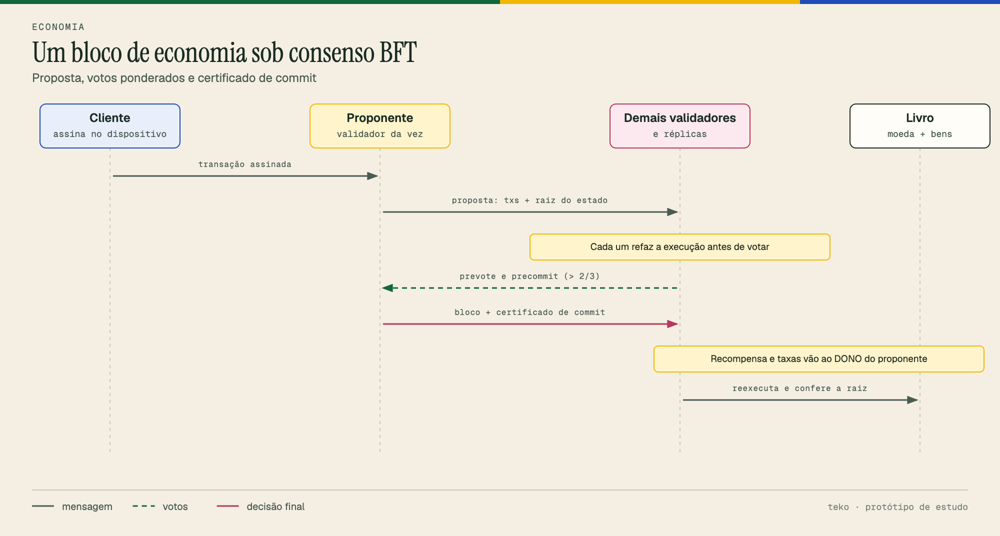
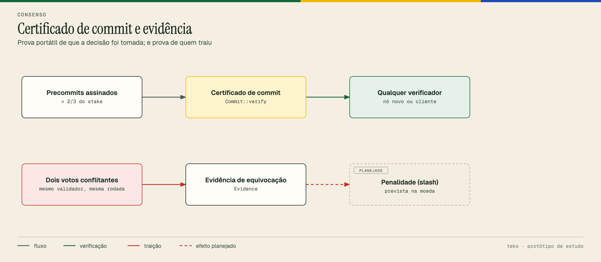
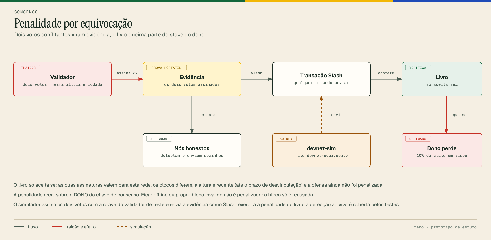

# Consenso BFT

← [Índice da documentação](../README.md)

## Resumo
`teko-bft` é um núcleo de consenso estilo **Tendermint**, ponderado por *stake*, sem I/O (tudo determinístico, testável por simulação). Tolera falhas bizantinas enquanto menos de 1/3 do stake é desonesto.

## Quem participa
Validadores com peso (stake), proponente por rodada.

## Diagramas

## Passo a passo
1. O proponente da rodada propõe um bloco.
2. Com bloco válido, cada validador faz **prevote**; com > 2/3 do stake, faz **precommit** e se trava no bloco.
3. Com > 2/3 de precommits há **commit**; o conjunto de votos forma o certificado, verificável por qualquer um (`Commit::verify`).
4. Se o prazo estoura, a rodada avança com novo proponente e timeout maior.
5. Nós atrasados recuperam por `Engine::on_commit`; `Engine::resend` retransmite votos.

## O que é verificado e por quem
Assinaturas dos votos e o quórum (> 2/3). Votos conflitantes do mesmo validador viram `Evidence` e **não** travam o consenso (os votos são contados por validador e bloco).

## O que pode dar errado
Partição de rede, mensagens perdidas, validadores parados ou desonestos: cobertos pelo simulador (atrasos, perda, partição, equivocador, pesos de stake; teste de estresse com 3000 redes, marcado `ignored`).

## Penalidade por equivocação e como simulá-la

Um validador que assina **dois votos conflitantes** (mesma altura, rodada e tipo, blocos diferentes) deixa uma **evidência**: os dois votos assinados. Qualquer um pode enviá-la em uma transação `Slash` (os nós honestos fazem isso sozinhos, [ADR-0030](../adr/0030-slash-automatico-e-bloqueio-persistido.md)). O livro confere que as assinaturas valem para esta rede, que os blocos diferem, que a altura é recente (até o prazo de desvinculação) e que a ofensa ainda não foi penalizada; então **queima** `slash_bps` do stake em risco (travado mais o que está saindo) do **dono** da chave de consenso. Ficar offline ou propor bloco inválido não é penalizado.

**Para ver acontecer na devnet:** trave stake na aba Validadores da Suite e rode `make devnet-equivocate` (opcional `VALIDATOR=0`). O comando assina dois votos com a chave do validador de teste, envia o `Slash` e mostra o stake e o queimado antes e depois; o explorador mostra o evento `slashed`. Limite honesto: o simulador exercita a **penalidade do livro**; a detecção ao vivo pelo motor BFT é coberta pelos testes (com um só validador a altura se decide no mesmo instante em que começa, então não dá para forjar votos pela rede de forma confiável).

## Onde está no código
`crates/teko-bft` (`engine.rs`, `types.rs`, `tests/sim.rs`).

## Testes que cobrem
`crates/teko-bft/tests/sim.rs`.

## Limites honestos
**Integrado às duas cadeias** (ADR-0028 e ADR-0034): o `teko-node` roda o mesmo motor BFT para o livro de **economia** (poder por stake) e para o livro de **votos** (instituições de poder igual), cada uma numa `Lane` (`tools/teko-node/src/lane.rs`), **sem blocos vazios** e com o horário do bloco conferido contra o relógio de cada validador. O proponente de cada rodada é sorteado por hash, proporcional ao poder; a penalidade (`Slash`) existe na moeda e a evidência é contada pelo nó. Implementação própria, sem auditoria.
