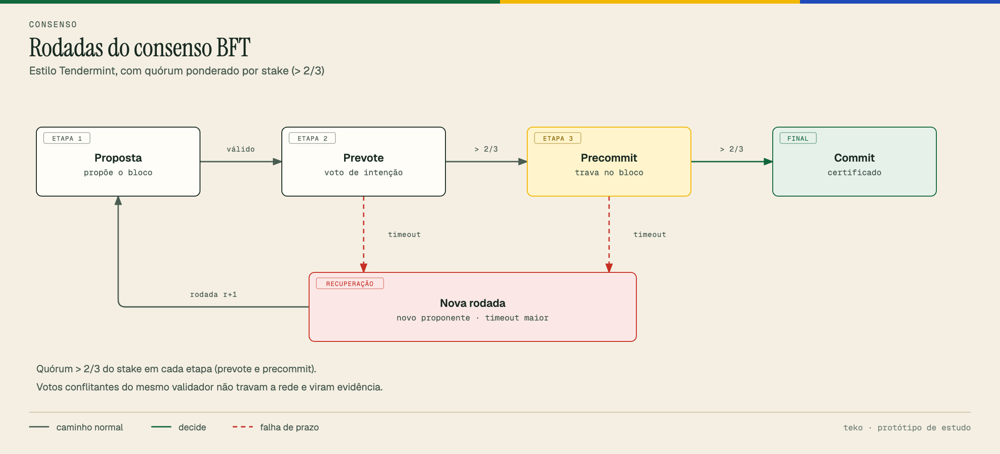

# Consenso BFT

← [Índice da documentação](../README.md)

## Resumo
`teko-bft` é um núcleo de consenso estilo **Tendermint**, ponderado por *stake*, sem I/O (tudo determinístico, testável por simulação). Tolera falhas bizantinas enquanto menos de 1/3 do stake é desonesto.

## Quem participa
Validadores com peso (stake), proponente por rodada.

## Diagramas

## Passo a passo
1. O proponente da rodada propõe um bloco.
2. Com bloco válido, cada validador faz **prevote**; com > 2/3 do stake, faz **precommit** e se trava no bloco.
3. Com > 2/3 de precommits há **commit**; o conjunto de votos forma o certificado, verificável por qualquer um (`Commit::verify`).
4. Se o prazo estoura, a rodada avança com novo proponente e timeout maior.
5. Nós atrasados recuperam por `Engine::on_commit`; `Engine::resend` retransmite votos.

## O que é verificado e por quem
Assinaturas dos votos e o quórum (> 2/3). Votos conflitantes do mesmo validador viram `Evidence` e **não** travam o consenso (os votos são contados por validador e bloco).

## O que pode dar errado
Partição de rede, mensagens perdidas, validadores parados ou desonestos: cobertos pelo simulador (atrasos, perda, partição, equivocador, pesos de stake; teste de estresse com 3000 redes, marcado `ignored`).

## Onde está no código
`crates/teko-bft` (`engine.rs`, `types.rs`, `tests/sim.rs`).

## Testes que cobrem
`crates/teko-bft/tests/sim.rs`.

## Limites honestos
**Integrado ao livro de economia** (M6a): o `teko-node` roda o motor BFT do `teko-economy` ao lado do PoA dos votos (que continua M-de-N fixo até o M6b). O proponente de cada rodada é sorteado por hash, proporcional ao poder; a penalidade (`Slash`) existe na moeda e a evidência é contada pelo nó. Implementação própria, sem auditoria.
