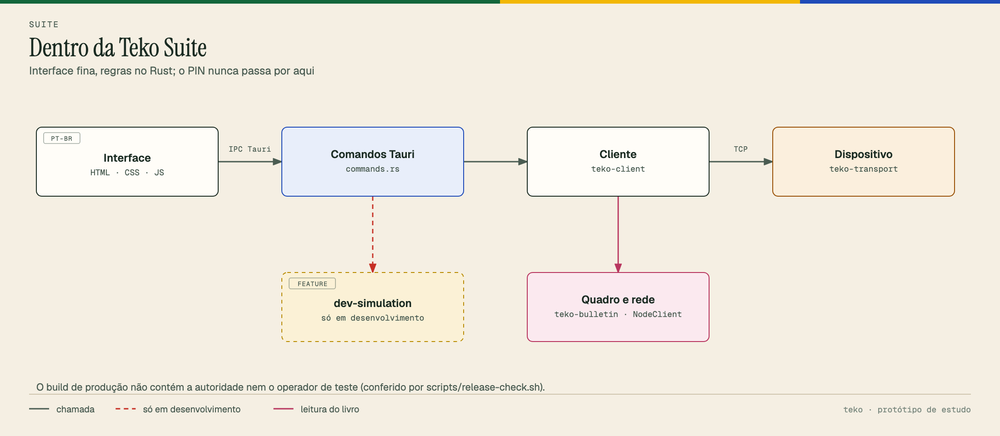
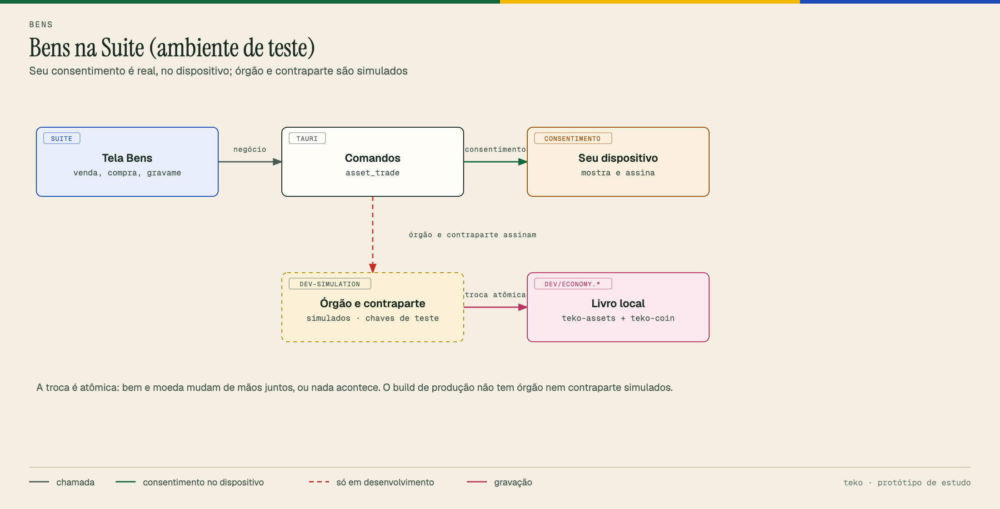

# Suite desktop

← [Índice da documentação](../README.md)

## Resumo
A **Teko Suite** é o app Tauri v2 (interface em HTML/CSS/JS, regras em Rust). Ela conversa com o dispositivo e a rede, mas **nunca** tem campo de PIN nem vê chaves. **Ela não emite nada**: credenciais (inclusive o ID cívico) são emitidas por órgãos no app **Teko Emissor** ([fluxo 16](16-credentials-on-chain.md)); a Suite pede, instala e lê.

## Quem participa
Interface, comandos Tauri, `teko-client`, dispositivo, quadro e rede.

## Diagramas

## Passo a passo
1. `make emulator` (terminal 1): o PIN é digitado **aqui**.
2. `make suite` (terminal 2): onboarding guiado (inclui a **Carteira** e a frase de recuperação e o pedido da **credencial cívica**; antes dela, Carteira, Bens, Credenciais e Validadores já funcionam), identidade, **Carteira** (endereço e saldo de teste), assinar, votar e **Resultados**. Para ter saldo de teste: `make fund ADDR=<seu endereço> AMOUNT=1000`.
3. Sem emulador ligado a Suite abre no Explorador público.
4. Pré-visualização só visual: `make preview` (usa backend falso fora do pacote).

## Tela Início
É a tela de abertura depois de desbloquear. Reúne, sem repetir lógica das outras telas: **saldo**, **bens**, **stake**, **votos pendentes** (pleitos abertos em que você pode votar e ainda não votou), o **ID Cívico**, o **endereço da carteira** e lembretes de segurança, com atalhos para cada área. Cada bloco carrega sozinho: se um falhar (por exemplo, não há livro de economia na rede), os outros continuam. Não tem nenhuma ação sensível própria.

## Resultados ao vivo e Exploração pública: verificação do quadro
As duas telas leem o **mesmo estado verificado** do quadro, que a Suite avança em passos e em paralelo e **aquece em segundo plano** desde que abre ([fluxo 07](07-tally-and-results.md), [ADR-0033](../adr/0033-verificacao-do-quadro-em-paralelo-e-em-passos.md)). Enquanto o quadro ainda está sendo verificado, a tela mostra uma barra "Verificando o quadro: X de Y" e os números do trecho já verificado, e pede de novo logo em seguida. Os comandos de saldo, bens e stake reaproveitam a cadeia de economia já verificada e baixam só os blocos novos. Se algo demorar mais de 300 ms, o terminal do `make suite` mostra uma linha `[suite] …` com o tempo.

## Tela Bens (ambiente de teste)

Mostra os bens em nome da sua carteira e permite **vender** ou **comprar** de uma contraparte simulada, além de pedir ao **órgão simulado** que registre um bem de teste (**imóvel ou veículo**, com formulário e botão "Preencher exemplo"), penhore ou libere. Os campos são validados em Rust (placa, RENAVAM com dígito verificador, chassi, anos); o cartão do bem mostra os metadados quando este computador os tem e eles conferem com a chain, e a **venda é bloqueada** sem isso. O dispositivo mostra o resumo (placa, modelo, ano) antes de você consentir. O **seu consentimento** é assinado no dispositivo; o resto é simulado e só existe com `dev-simulation`. Decisão: [ADR-0026](../adr/0026-bens-na-suite-com-orgao-e-contraparte-simulados.md).

## Tela Validadores (ambiente de teste)
Mostra saldo livre, **seu stake**, saídas pendentes e a lista de validadores com a **parcela do poder de voto**; permite **travar**, **sair** e **resgatar**, sempre com a confirmação no dispositivo ([ADR-0027](../adr/0027-stake-assinado-no-dispositivo.md)). Com a rede de teste no ar (`make devnet`), a tela usa a **cadeia verificada dos nós** (consenso BFT) e mostra a **fase de fundador** (progresso até N) e os validadores por poder de voto; sem rede, usa o livro local de teste. Decisão: [ADR-0028](../adr/0028-economia-sobre-bft-e-fase-de-fundador.md).

## O que é verificado e por quem
A Suite confere atestação, firmware e a cadeia do nó; as confirmações sensíveis são do dispositivo.

## O que pode dar errado
Resultados antigos ou eleição trocada: a Suite amarra o cache à primeira entrada do quadro. Dados de teste só aparecem no build de desenvolvimento.

## Onde está no código
`apps/suite/src-tauri/src/commands.rs`, `apps/suite/ui`, `crates/teko-client`, `crates/teko-transport`.

## Testes que cobrem
`crates/teko-client/tests/e2e.rs` (onboarding ponta a ponta sem janela) e `scripts/release-check.sh` (o build de produção não tem `dev-simulation` nem botões automáticos).

## Limites honestos
Botões automáticos do emulador existem apenas sob a feature `test-buttons`, nunca no build normal.
