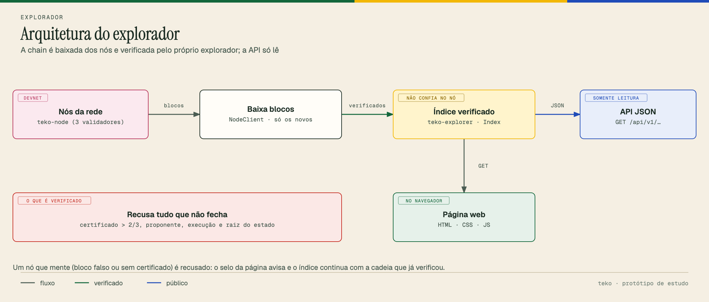
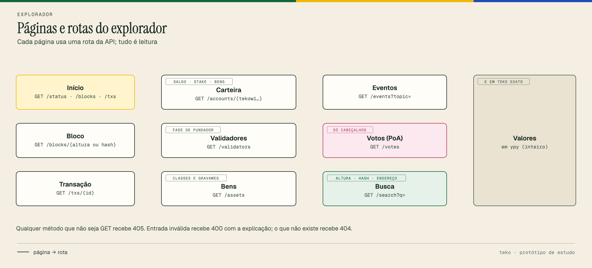

# Explorador da chain

← [Índice da documentação](../README.md)

## Resumo
O **Teko Explorer** é uma página web local, com uma **API JSON somente leitura**, para ver a blockchain: blocos, transações com taxa e valor, carteiras (saldo, stake, bens), validadores e a fase de fundador, eventos e o livro de votos. Ele **não confia nos nós**: baixa os blocos e **verifica sozinho** cada certificado, proponente, execução e raiz do estado. É o desenho de um "Etherscan" do Teko; hoje roda sobre a devnet local. Decisão: [ADR-0031](../adr/0031-explorador-da-chain.md).

## Quem participa
Os nós da rede (`teko-node`), o `NodeClient` que baixa blocos, o índice verificado (`teko-explorer`), o servidor (`explorer-server`, binário `teko-explorer`) e o navegador.

## Diagramas

## Passo a passo
1. Suba a rede e o explorador: `make devnet FOUNDER=tekow1…` e, em outro terminal, `make explorer` (abre em `http://127.0.0.1:8545`).
2. A cada 2 s o servidor pede aos nós **só os blocos novos** e entrega ao índice. O índice reexecuta cada bloco: confere o certificado de commit (> 2/3 do poder do conjunto daquela altura), o proponente da rodada, a execução das transações e a **raiz do estado**.
3. Um bloco que não fecha é **recusado**; o índice segue com o que já verificou, tenta o próximo nó e o selo da página mostra o motivo.
4. A API serve as visões (`GET /api/v1/status`, `blocks`, `blocks/{altura ou hash}`, `txs`, `txs/{id}`, `accounts/{tekow1…}`, `validators`, `assets`, `events`, `search?q=`, `votes`). Todo valor vem em **ypy** (inteiro) e em **TEKO** exato ([ADR-0029](../adr/0029-unidade-teko-e-ypy.md)).
5. A página busca por altura, hash de bloco, id de transação, endereço `tekow1…` ou chave de validador, e se atualiza sozinha.

## O que é verificado e por quem
- **Pelo explorador:** certificado de cada bloco, proponente, execução e raiz do estado (o mesmo `EconomyChain::apply_decided_outcome` que os nós usam). Saldos, oferta e fase de fundador mostrados vêm do estado que **ele** reconstruiu.
- **Livro de votos (PoA):** `NodeClient::sync_chain` verifica assinaturas M-de-N, encadeamento e o log Merkle; a página mostra só cabeçalhos e contagens por tipo de entrada.
- **Pelo navegador:** nada; todo texto vindo da API é escapado antes de virar HTML, e a CSP não permite script ou estilo inline.

## O que pode dar errado
- **Nó mente ou está atrasado:** bloco com certificado falso é recusado; um nó atrasado só faz o explorador mostrar uma altura menor.
- **Rede fora do ar:** o selo avisa "sem resposta" e a página mostra o último estado verificado.
- **Endereço que nunca apareceu:** a carteira abre com zeros e o aviso "ainda não apareceu na cadeia".
- **Entrada inválida:** a API responde 400 com a explicação; rota inexistente, 404; qualquer método diferente de GET, 405.

## Onde está no código
- `crates/teko-explorer`: `Index` (verificação, blocos, transações, contas, validadores, bens, eventos, busca) e os modelos JSON.
- `crates/teko-economy/src/chain.rs`: `apply_decided_outcome` (devolve recibos e eventos).
- `tools/explorer-server`: `state.rs` (sincronização), `api.rs` (rotas), `votes.rs` (livro de votos), `ui/` (página).
- `tools/teko-node/src/client.rs`: `econ_fetch_from_node`.
- `make explorer`; `teko-explorer --dir dev/net --port 8545 [--bind … --public]`.

## Testes que cobrem
- `crates/teko-explorer/tests/index.rs`: recompensas e oferta batem com o livro; transferência decodificada e busca; certificado falso recusado; sincronização em partes igual à completa; paginação; validadores.
- `tools/explorer-server/tests/api.rs`: somente leitura (405), rotas estáticas, entradas inválidas, estado da gênese.
- `tools/explorer-server/tests/e2e.rs`: 3 nós reais, o explorador verifica a cadeia, decodifica uma transferência e mostra o livro de votos.

## Limites honestos
- O índice vive **em memória** e é reconstruído a partir da cadeia: ótimo para a devnet, não para milhões de blocos.
- A página consulta a cada poucos segundos (sem WebSocket). Não há autenticação nem HTTPS: em produção, só atrás de um proxy reverso (`--public` é obrigatório fora de loopback).
- **Controles de desenvolvimento (estilo Ganache) ainda não existem**: faucet para outro endereço, reiniciar a rede e ritmo dos blocos dependem de uma decisão de produto (ADR-0031). Planejado.
- O quadro de votação com provas de inclusão Merkle continua na Suite; o explorador mostra só o livro PoA.
- Sem auditoria.
