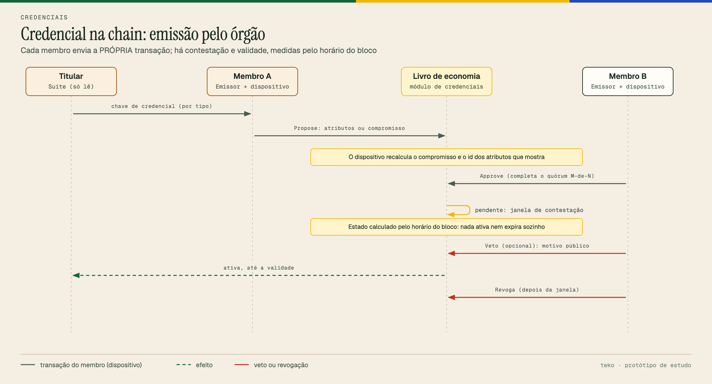

# Credenciais na chain e app do emissor

← [Índice da documentação](../README.md)

## Resumo
Permissões e cargos (CNH A, CNH B, candidato a cargo X…) viram **credenciais na chain**, emitidas por **órgãos e comunidades autorizados** num **app separado** (Teko Emissor), com o dispositivo do membro plugado. Cada credencial tem uma **janela de contestação** (em que o órgão pode vetar) e uma **validade**. A Suite do cidadão só **lê**. Decisão: [ADR-0037](../adr/0037-credenciais-na-chain-emitidas-por-orgaos.md).

## Quem participa
- **Titular:** gera, na Suite e confirmando no dispositivo, a **chave de credencial do tipo** e a entrega ao órgão.
- **Membros do órgão:** cada um tem o endereço da **sua carteira** registrado no tipo (na gênese); assinam no **próprio dispositivo**.
- **Livro de economia:** módulo `teko-credentials` (id 3), verificado por todos os nós.
- **Suite** (leitura) e **Emissor** (emite, aprova, veta, revoga).

## Diagrama


## Passo a passo
1. O titular abre **Credenciais** na Suite e gera a chave do tipo (ex.: `cnh-b`). O dispositivo mostra "CHAVE DE CREDENCIAL" e só exporta a chave pública, **sem ligação** com identidade, carteira e voto.
2. O membro A abre o **Emissor** (`make issuer`), escolhe o tipo, cola a chave, informa os atributos (`nome=Ana;categoria=B`) e a validade. O dispositivo mostra tudo (tipo, titular, atributos, validade, janela) e, após o botão físico, assina `Propose`: é a **primeira aprovação**.
3. Os demais membros **aprovam** (cada um com a própria transação). Ao chegar a **M**, a credencial fica **Pendente** por `contest` segundos.
4. Na janela, o quórum pode **vetar** (motivo público). Passada a janela, a credencial está **Ativa**, até `valid_until` (ou vitalícia, conforme o tipo). Depois só o quórum pode **revogar** (motivo público).
5. **Privado × público:** tipos privados (CNH) guardam na chain só um **compromisso salgado**; o Emissor entrega ao titular o pacote com atributos e sal. Tipos públicos (candidato) guardam os atributos em claro.

## O que é verificado e por quem
- Os **nós** conferem: só membro propõe/aprova/veta/revoga; cada membro conta uma vez; janela e validade pelo horário do bloco; compromisso dos tipos públicos.
- O **dispositivo** recalcula o compromisso e o id **dos atributos que mostra** e monta a transação inteira; o cliente refaz a mesma transação e confere a assinatura (`teko-client`).
- O **explorador** mostra cada operação (módulo "credentials").

## O que pode dar errado
- Membro ou quórum emitem algo **falso** ou vetam por abuso: o livro prova **quem** emitiu, não a verdade (oráculo). Falta caução do órgão.
- Quem tem o dispositivo e o PIN de um membro age como o membro.
- A chave de credencial é estável por tipo: duas credenciais do mesmo tipo do mesmo titular são ligáveis.
- Sem troca de membros em execução (só na gênese).

## Onde está no código
`crates/teko-credentials` (módulo), `crates/teko-economy/src/genesis.rs` (`credtype=`), `crates/teko-device-core/src/device.rs` (`get_credential_key`, `sign_credential_op`), `crates/teko-crypto/src/ledger.rs` (payloads, compromisso, id), `crates/teko-client/src/lib.rs`, `apps/issuer` (Emissor), `apps/suite` (tela Credenciais), `tools/devnet-sim` (`cosign`), `tools/teko-node/src/setup.rs` (órgãos de teste).

## Testes que cobrem
`crates/teko-credentials/tests/credentials.rs`, `crates/teko-economy/tests/chain.rs`, `crates/teko-device-core/src/tests.rs`, `crates/teko-client/tests/e2e.rs`, `tools/devnet-sim/tests/e2e.rs`. Ver [TEST-MATRIX](../TEST-MATRIX.md).

## Para ver funcionando
```
make devnet FOUNDER=tekow1… [ISSUER=tekow1…]   # a carteira do emissor entra nos órgãos de teste (2-de-3)
make emulator                                   # o dispositivo (PIN no emulador)
make issuer                                     # o Emissor: emitir, aprovar, vetar, revogar
make devnet-cosign                              # SIMULA os outros membros aprovando (só dev)
make suite                                      # Credenciais: sua chave por tipo e o que foi emitido; ID cívico: pedir e instalar o pacote
```

## Limites honestos
Sem validade jurídica; sem auditoria; só devnet. A **credencial de identidade cívica** é o tipo `civic` ([fluxo 03](03-credentials-and-reissue.md), [ADR-0038](../adr/0038-id-civico-como-credencial-na-chain.md)). As **candidaturas na eleição** e o **registro de eleitos** são a etapa B (planejado).
