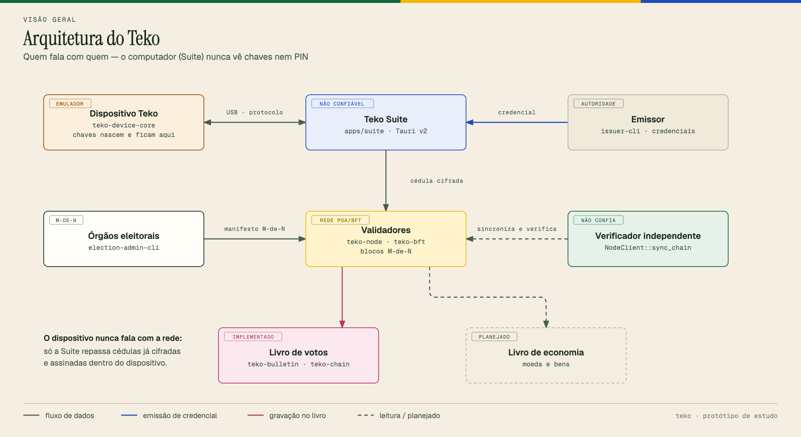
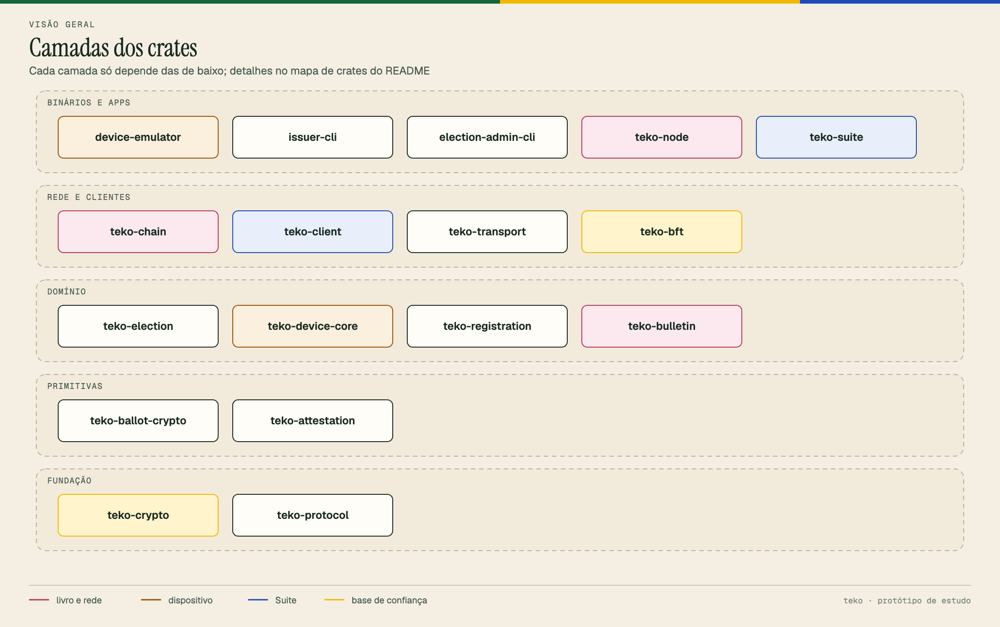

# Visão geral

← [Índice da documentação](../README.md)

## Resumo
O Teko junta três peças: um **dispositivo de identidade** (hoje emulado), a **Suite** no computador e uma **rede de validadores** que guarda, em blocos assinados, tudo o que é público numa eleição. O computador nunca é confiável: ele só repassa dados públicos. Chaves, PIN e confirmações vivem no dispositivo.

## Quem participa
- **Cidadão**: confirma tudo olhando a tela do dispositivo.
- **Dispositivo** (`teko-device-core`): cria e guarda as chaves, assina, cifra a cédula.
- **Suite** (`apps/suite`): interface; fala com o dispositivo, o emissor e a rede.
- **Emissor** (`issuer-cli`): autoridade que emite credenciais e revoga identidades.
- **Órgãos eleitorais** (`election-admin-cli`): governam a eleição em M-de-N.
- **Validadores** (`teko-node`): produzem e verificam blocos.
- **Verificador independente**: qualquer pessoa que refaz a verificação (`NodeClient`).

## Diagramas

*Fontes: [SVG](../diagramas/arquitetura-macro.svg) · [HTML](../diagramas/arquitetura-macro.html)*

*Fontes: [SVG](../diagramas/camadas-crates.svg) · [HTML](../diagramas/camadas-crates.html)*

## Passo a passo
1. O cidadão **configura o dispositivo** e recebe uma credencial ([identidade](01-identidade-e-dispositivo.md), [credenciais](03-credenciais-e-reemissao.md)).
2. Os órgãos **publicam a eleição** e os validadores fazem a **cerimônia de chave** ([ciclo](06-ciclo-da-eleicao.md), [cerimônia](08-cerimonia-de-chave.md)).
3. O cidadão **registra-se de forma anônima** e **vota** ([registro](04-registro-anonimo.md), [votação](05-votacao-cifrada.md)).
4. Os blocos são produzidos e verificados ([blocos](09-blocos-e-validacao.md), [rede](10-rede-e-sincronizacao.md)).
5. Após o prazo, só o **total** é decifrado e mostrado ([apuração](07-apuracao-e-resultados.md)).

## Princípios inegociáveis
1. O computador é não confiável. 2. Confirmação sensível só no dispositivo. 3. Chaves nascem no dispositivo e não saem. 4. Firmware só roda se assinado M-de-N. 5. Identidade e voto são separados. 6. Atestação sem rastreamento. Detalhes e testes: [THREAT-MODEL](../THREAT-MODEL.md) e [TEST-MATRIX](../TEST-MATRIX.md).

## O que é verificado e por quem
- Dispositivo: firmware, atestação, PIN e cada confirmação.
- Rede: cada bloco por qualquer réplica; clientes não confiam em nós.

## O que pode dar errado
Um computador infectado, um validador desonesto ou um órgão que perdeu a chave. Cada fluxo abaixo descreve a defesa.

## Onde está no código
Mapa completo de crates no [README](../../README.md#mapa-de-crates). Arquitetura técnica: [ARCHITECTURE](../ARCHITECTURE.md).

## Testes que cobrem
`make test` roda todos (unit, proptest e ponta a ponta). Invariante → teste em [TEST-MATRIX](../TEST-MATRIX.md).

## Limites honestos
Protótipo de estudo: dispositivo emulado, criptografia própria **sem auditoria**, rede de teste sem valor real, sem validade jurídica. O livro de economia (moeda e bens) é só **planejado** ([fluxo 12](12-livro-razao-moeda-e-bens.md)).
