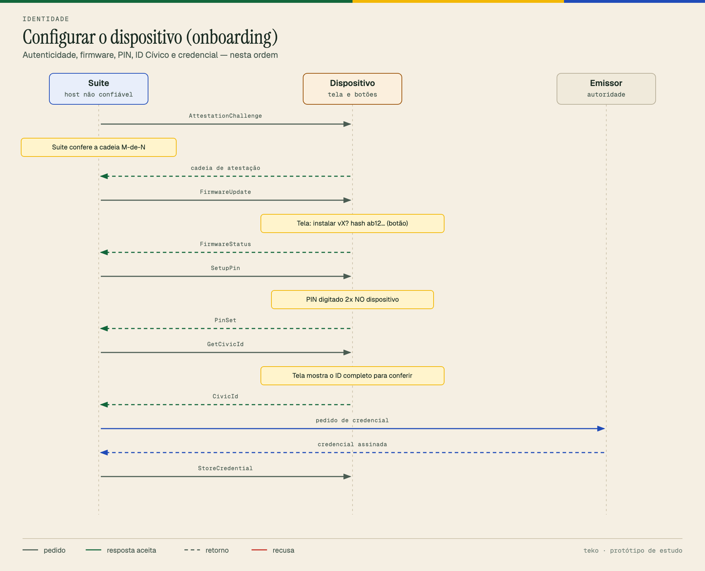
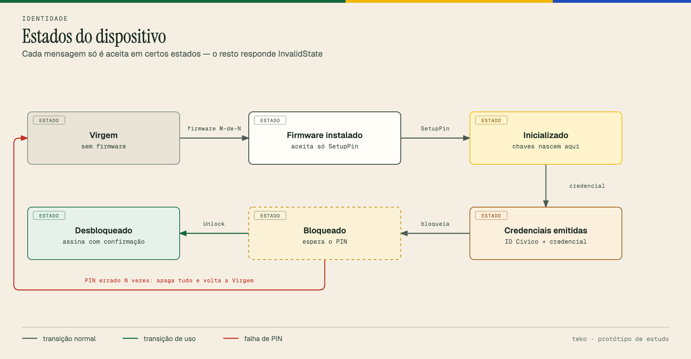
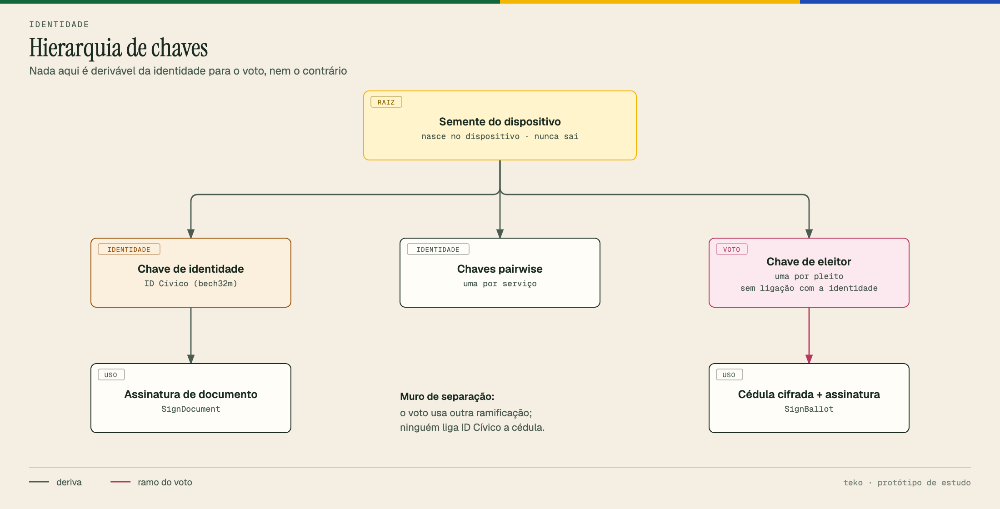

# Identidade e dispositivo

← [Índice da documentação](../README.md)

## Resumo
Antes de qualquer voto, o dispositivo precisa provar que é autêntico, rodar firmware assinado por várias instituições, ter um PIN e gerar o **ID Cívico**. Tudo isso acontece em uma ordem fixa, imposta por uma máquina de estados.

## Quem participa
Suite (host não confiável), dispositivo, emissor.

## Diagramas

*Fontes: [SVG](../diagramas/onboarding.svg) · [HTML](../diagramas/onboarding.html)*

*Fontes: [SVG](../diagramas/estados-dispositivo.svg) · [HTML](../diagramas/estados-dispositivo.html)*

*Fontes: [SVG](../diagramas/hierarquia-chaves.svg) · [HTML](../diagramas/hierarquia-chaves.html)*

## Passo a passo
1. **Atestação**: a Suite envia um desafio; o dispositivo responde com a cadeia de atestação; a Suite confere a assinatura M-de-N.
2. **Firmware**: o manifesto precisa de M-de-N assinaturas; versão menor que a instalada é recusada (downgrade). A tela pede confirmação.
3. **PIN**: digitado duas vezes **no dispositivo**. Nenhuma mensagem do protocolo carrega o PIN.
4. **ID Cívico**: a semente nasce e o ID (bech32m, com checksum) aparece na tela para conferência.
5. **Credencial**: o emissor assina e a Suite a guarda no dispositivo ([fluxo 03](03-credenciais-e-reemissao.md)).

## O que é verificado e por quem
- Atestação e firmware: pela Suite e pelo próprio dispositivo (M-de-N).
- PIN: só pelo dispositivo, em tempo constante; erros repetidos **apagam** o dispositivo.

## O que pode dar errado
Firmware com menos de M assinaturas, versão antiga, PIN errado N vezes (apaga e volta a Virgem), mensagem fora do estado (`InvalidState`).

## Onde está no código
`crates/teko-device-core` (`state.rs`, `pin.rs`, `device.rs`), `crates/teko-attestation`, `crates/teko-crypto` (`ids.rs`, `keys.rs`), `crates/teko-protocol`. Catálogo de mensagens: [DEVICE-PROTOCOL](../DEVICE-PROTOCOL.md); chaves: [KEY-HIERARCHY](../KEY-HIERARCHY.md); passos: [ONBOARDING-FLOW](../ONBOARDING-FLOW.md).

## Testes que cobrem
Proptests de PIN, firmware M-de-N, downgrade e ID Cívico (checksum); teste ponta a ponta `crates/teko-client/tests/e2e.rs`.

## Limites honestos
O emulador não tem isolamento de hardware; o compartimento seguro é simulado.
