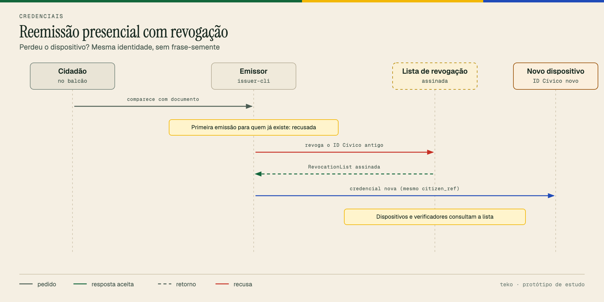

# Credenciais e reemissão

← [Índice da documentação](../README.md)

## Resumo
A credencial liga seus atributos (por exemplo, estado e município) ao dispositivo. Se o dispositivo for perdido, o emissor faz uma **reemissão presencial**: revoga o ID antigo e emite um novo, com a **mesma identidade cidadã** e **sem frase-semente**.

## Quem participa
Cidadão, emissor, lista de revogação, novo dispositivo.

## Diagramas

*Fontes: [SVG](../diagramas/reemissao-revogacao.svg) · [HTML](../diagramas/reemissao-revogacao.html)*

## Passo a passo
1. Primeira emissão: o emissor cria um `citizen_ref` estável e assina a credencial.
2. Perda do dispositivo: o cidadão comparece com documento.
3. O emissor **revoga** o ID Cívico antigo (`RevocationList` assinada).
4. O emissor emite a credencial do novo dispositivo, mantendo o `citizen_ref`.
5. Verificadores consultam a lista; credenciais revogadas deixam de valer.

## O que é verificado e por quem
Assinatura do emissor (na credencial e na lista); o registro de eleitor ocorre **uma vez por cidadão por pleito**, mesmo após reemissão.

## O que pode dar errado
Primeira emissão para quem já existe: **recusada**. Fraude presencial: depende do processo humano do emissor.

## Onde está no código
`tools/issuer-cli` (`reissue`, `revoke`), `crates/teko-crypto/src/credential.rs`. Decisão: [RECOVERY](../RECOVERY.md).

## Testes que cobrem
Testes do `issuer-cli` e do registro (uma vez por cidadão) em `tools/election-admin-cli/tests`.

## Limites honestos
Por escolha, a **identidade** não tem seed/mnemônico: a recuperação depende do emissor. (A **carteira** tem frase de recuperação própria e independente: [fluxo 14](14-carteira-e-seed.md).) A autoridade e o operador de teste só existem com a feature `dev-simulation`.
