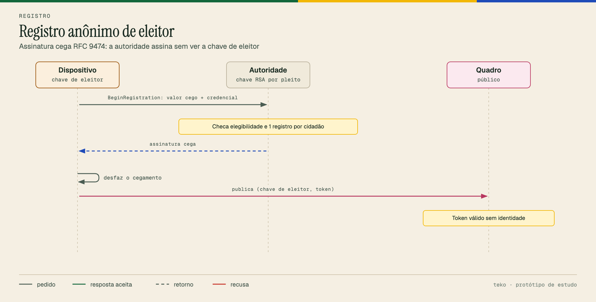

# Registro anônimo

← [Índice da documentação](../README.md)

## Resumo
Para votar, o eleitor precisa provar que é elegível **sem que a autoridade saiba qual chave de eleitor será usada**. Isso é feito com **assinatura cega RSA (RFC 9474)**: a autoridade assina um valor cego e o dispositivo remove o cegamento depois.

## Quem participa
Dispositivo, autoridade de registro (chave RSA por pleito), quadro público.

## Diagramas

*Fontes: [SVG](../diagramas/registro-cego.svg) · [HTML](../diagramas/registro-cego.html)*

## Passo a passo
1. `BeginRegistration`: o dispositivo calcula o valor cego da própria chave de eleitor e mostra "REGISTRAR PARA VOTAR?".
2. A autoridade confere elegibilidade e que o cidadão não se registrou antes; devolve a assinatura cega.
3. `FinishRegistration`: o dispositivo desfaz o cegamento e **recusa** resposta que não vire assinatura válida.
4. O par (chave de eleitor, token) é publicado no quadro, **fora** do diálogo com a autoridade.

## O que é verificado e por quem
A autoridade: elegibilidade e unicidade. Qualquer um: o token é válido para a chave de eleitor, sem revelar quem é o cidadão.

## O que pode dar errado
Publicar o par junto do diálogo com a autoridade enfraquece o anonimato (por isso são canais separados).

## Onde está no código
`crates/teko-registration` (`bsrsa.rs`, validado contra o vetor do RFC), `crates/teko-election/src/registration.rs`. Decisão: [ADR-0008](../adr/README.md).

## Testes que cobrem
`crates/teko-registration/tests/rfc9474*.rs` e `flow.rs`.

## Limites honestos
RSA próprio, sem auditoria. ADR-0008 aceito provisoriamente.
