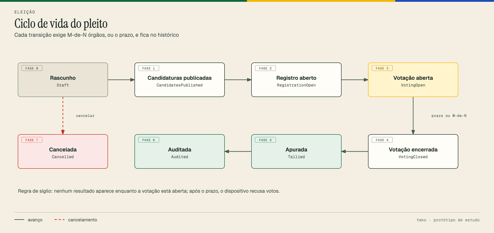

# Ciclo da eleição

← [Índice da documentação](../README.md)

## Resumo
Cada pleito (cargo e jurisdição) passa por fases fixas. O **manifesto** da eleição diz quem a governa (M-de-N órgãos) e cada mudança de fase vira uma transição assinada, guardada no histórico.

## Quem participa
Órgãos eleitorais, validadores, dispositivo (que confere o histórico e o prazo).

## Diagramas

*Fontes: [SVG](../diagramas/ciclo-eleicao.svg) · [HTML](../diagramas/ciclo-eleicao.html)*

## Passo a passo
1. `make election` cria o manifesto de exemplo (7 pleitos); `make publish` o publica no quadro.
2. Os órgãos avançam as fases com M-de-N assinaturas.
3. A votação só aceita cédulas em `VotingOpen`; o prazo é conferido **pelo dispositivo** e por `election-admin close-due`.
4. Após o prazo o pleito é encerrado e a apuração libera o resultado ([fluxo 07](07-apuracao-e-resultados.md)).

## O que é verificado e por quem
O dispositivo recusa histórico mais antigo que o que já viu (`LoadElection` confere M-de-N e o histórico). `results_visibility` precisa estar declarado no manifesto.

## O que pode dar errado
Manifesto inválido (por exemplo sem `results_visibility`), órgãos sem quórum, relógio errado.

## Onde está no código
`crates/teko-election` (`manifest.rs`, `lifecycle.rs`, `policy.rs`), `tools/election-admin-cli`. Decisões: [ADR-0016](../adr/0016-manifesto-de-eleicao-e-governanca.md), [ADR-0017](../adr/0017-cargos-jurisdicao-e-elegibilidade.md), [ADR-0018](../adr/0018-resultados-ao-vivo-e-visibilidade.md).

## Testes que cobrem
`tools/election-admin-cli/tests/admin.rs` e `network.rs`, testes de ciclo em `teko-election`.

## Limites honestos
Governança de protótipo: as chaves dos órgãos são de teste. Pontos em aberto em [PHASE-2-VOTING](../PHASE-2-VOTING.md) §10.
