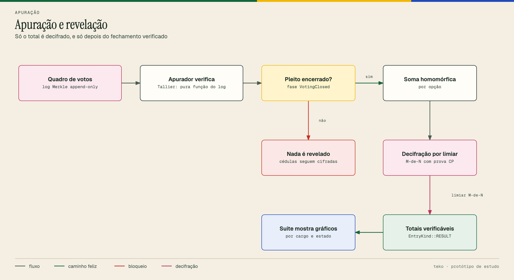

# Apuração e resultados

← [Índice da documentação](../README.md)

## Resumo
Enquanto a votação está aberta **nada é mostrado**. Depois do fechamento, as cédulas são somadas **ainda cifradas** e só o **total por opção** é decifrado, por limiar (M-de-N validadores). A Suite mostra gráficos por cargo e estado.

## Quem participa
Quadro, apurador (`Tallier`), validadores com suas partes da chave, Suite.

## Diagramas

*Fontes: [SVG](../diagramas/apuracao.svg) · [HTML](../diagramas/apuracao.html)*

## Passo a passo
1. `make close` (ou o prazo) encerra os pleitos.
2. O `Tallier`, função pura do log, verifica cada entrada.
3. Soma homomórfica por opção.
4. Cada validador publica sua ação de decifração com prova (`EntryKind::RESULT`); com M delas o total é combinado.
5. Quem quiser refaz a conta: `make tally` ou a Suite (aba **Resultados**).

## O que é verificado e por quem
Qualquer um confere as provas das ações de decifração contra a chave pública da cerimônia. O serviço de resultado do nó só responde **depois do fechamento verificado**.

## O que pode dar errado
M validadores em conluio poderiam abrir **antes** do prazo. Resultado desatualizado na Suite foi corrigido: o cache é amarrado à primeira entrada do quadro.

## Onde está no código
`crates/teko-election/src/tally.rs`, `result.rs`, `crates/teko-ballot-crypto`, `tools/teko-node`.

## Testes que cobrem
Testes de apuração em `teko-election`, `tools/election-admin-cli/tests`, simulador de eleitores (`make simulate`).

## Limites honestos
Dados simulados sempre rotulados. A privacidade perante M validadores desonestos depende da confiança no limiar.
