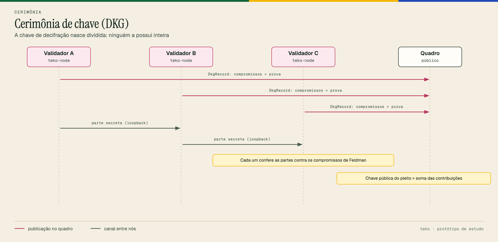

# Cerimônia de chave

← [Índice da documentação](../README.md)

## Resumo
A chave que decifra os totais não existe inteira em lugar nenhum. Os validadores executam um **DKG de Feldman**: cada um contribui, e a chave pública do pleito é a soma.

## Quem participa
Validadores A, B, C e o quadro.

## Diagramas

*Fontes: [SVG](../diagramas/cerimonia-dkg.svg) · [HTML](../diagramas/cerimonia-dkg.html)*

## Passo a passo
1. `make devnet` sobe os 3 validadores; `make devnet-dkg` inicia a cerimônia.
2. Cada um publica um `DkgRecord` (compromissos + prova de posse de Schnorr).
3. Trocam partes secretas por canal direto.
4. Cada um confere as partes contra os compromissos e guarda a sua (`tally-share.key`).
5. A chave pública (`tally-key.pub`) entra no manifesto.

## O que é verificado e por quem
Os compromissos e provas são públicos; um envio errado é detectado por quem recebe.

## O que pode dar errado
Cerimônia antiga com manifesto novo ("DIFERENTE da do manifesto"): use `make devnet-reset` e refaça.

## Onde está no código
`crates/teko-ballot-crypto/src/dkg.rs`, `dkg_wire.rs`, `tools/teko-node/src/dkg.rs`.

## Testes que cobrem
Unit e rede em `tools/teko-node/tests/network.rs`.

## Limites honestos
O canal entre nós é **loopback** (mesma máquina), sem cifra de transporte própria; uma rede real exigiria canal autenticado.
