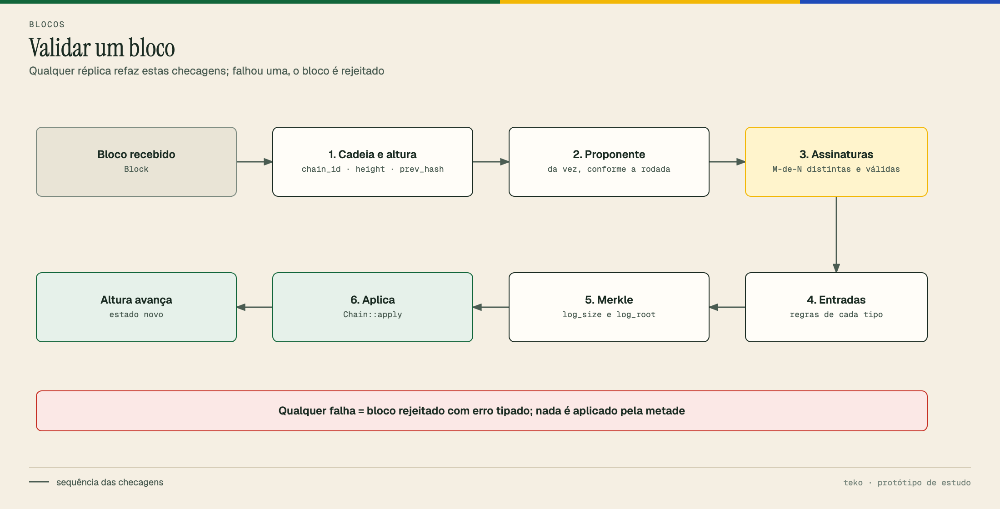

# Blocos e validação

← [Índice da documentação](../README.md)

## Resumo
Um bloco agrupa entradas (manifesto, registros, cédulas, DKG, resultados) e é aceito só com **M-de-N assinaturas** de validadores. Qualquer réplica refaz a validação inteira antes de aplicar.

## Quem participa
Proponente, validadores e réplicas (`Chain::apply`).

## Diagramas

*Fontes: [SVG](../diagramas/bloco-validacao.svg) · [HTML](../diagramas/bloco-validacao.html)*

## Passo a passo
Um bloco carrega `chain_id`, `height`, `prev_hash`, `proposer`, `round`, `entries`, `log_size`, `log_root` e `signatures`.
1. Confere cadeia, altura e `prev_hash`.
2. Confere se o proponente é o da vez.
3. Confere M assinaturas distintas e válidas (incluindo a do proponente).
4. Valida cada entrada pelas regras do seu tipo.
5. Recalcula tamanho e raiz Merkle do log.
6. Aplica e avança a altura.

## O que é verificado e por quem
Todas as réplicas e todo cliente que sincroniza. Duas assinaturas do mesmo proponente para blocos diferentes na mesma altura são **equívoco** e detectadas.

## O que pode dar errado
Bloco forjado, fork, proponente fora de turno, entrada inválida: o bloco é rejeitado com erro tipado.

## Onde está no código
`crates/teko-chain` (`block.rs`, `chain.rs`, `profile.rs`), `crates/teko-bulletin` (Merkle).

## Testes que cobrem
Testes de `teko-chain` e `tools/teko-node/tests/network.rs`.

## Limites honestos
Perfis: `devnet` e `testnet` existem; **mainnet está travada**. Esta é a rede PoA federada; o consenso BFT ([fluxo 11](11-consenso-bft.md)) ainda não está integrado ao nó.
