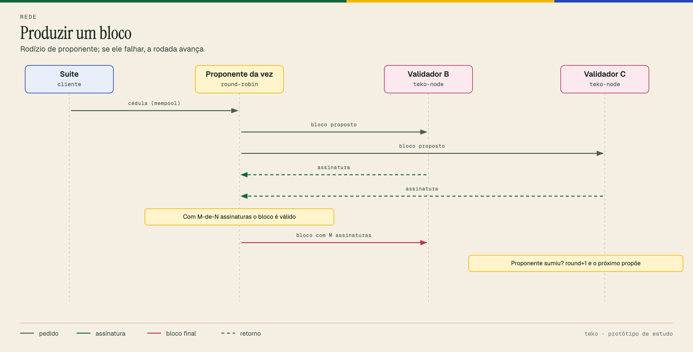
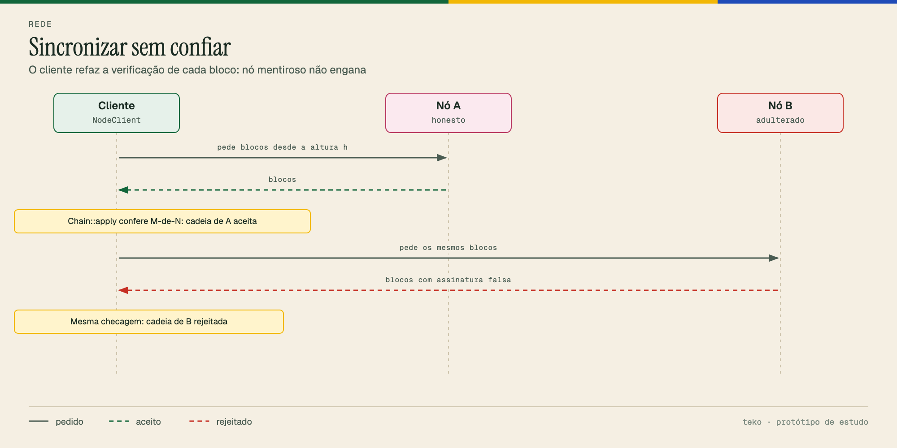

# Rede e sincronização

← [Índice da documentação](../README.md)

## Resumo
Os validadores (`teko-node`) trocam transações e blocos por *gossip*, revezam o proponente e trocam de turno se ele falhar. Clientes (Suite, `election-admin`, verificador) **não confiam em nenhum nó**: baixam os blocos e refazem a verificação.

## Quem participa
Suite ou cliente, proponente da vez, demais validadores.

## Diagramas

*Fontes: [SVG](../diagramas/producao-bloco.svg) · [HTML](../diagramas/producao-bloco.html)*

*Fontes: [SVG](../diagramas/sincronizacao.svg) · [HTML](../diagramas/sincronizacao.html)*

## Passo a passo
1. A transação chega ao *mempool*.
2. O proponente da vez monta o bloco e coleta M assinaturas.
3. Se ele não responde, a `round` sobe e o próximo propõe.
4. O cliente usa `NodeClient::sync_chain` / `sync_into` e aplica cada bloco por `Chain::apply`.

## Como operar (make)
`make devnet` → `make devnet-dkg` → `make devnet-status` / `make devnet-blocks` → `make devnet-stop`. Limpeza: `make devnet-reset`. Detalhes: [NETWORKS](../NETWORKS.md).

## O que é verificado e por quem
O cliente verifica toda a cadeia; nó com assinatura falsa é descartado.

## O que pode dar errado
Nós órfãos de uma execução antiga ("not this proposer's turn", "Address already in use"): `make devnet-stop` encerra os órfãos.

## Onde está no código
`tools/teko-node` (`node.rs`, `client.rs`, `wire.rs`), `crates/teko-chain`.

## Testes que cobrem
`tools/teko-node/tests/network.rs` (portas alocadas globalmente para não colidir).

## Limites honestos
PoA federada, não finalidade bizantina. Sem rede entre máquinas ainda.
