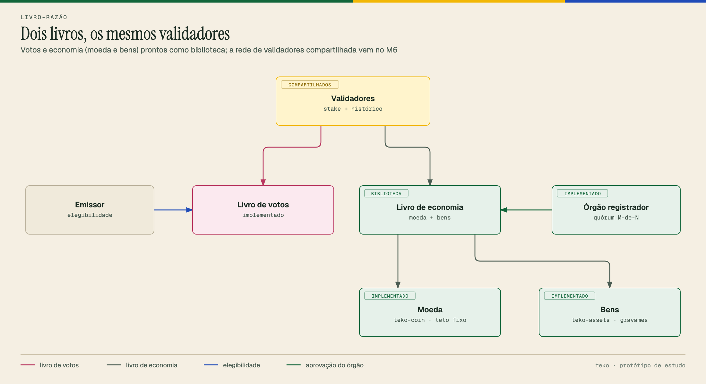
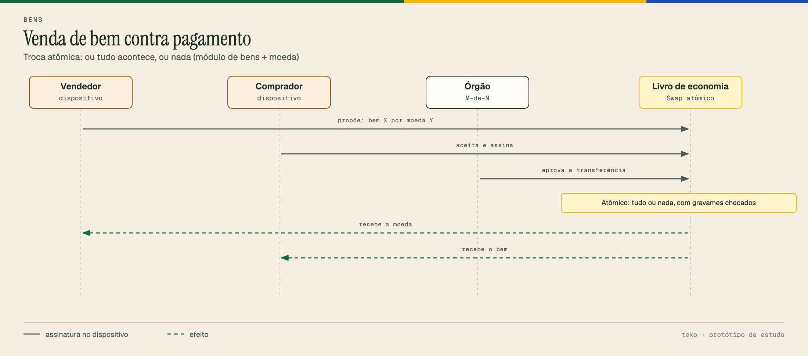
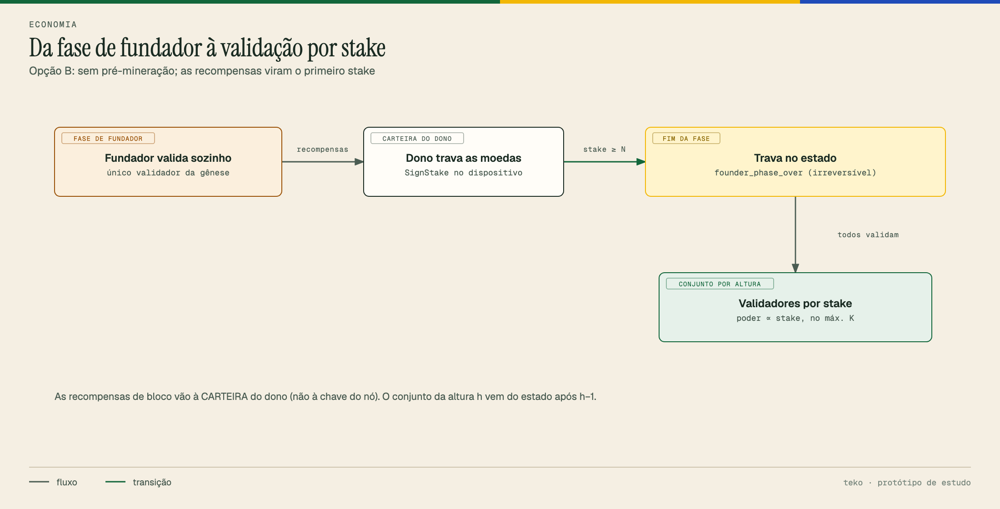

# Livro-razão, moeda e bens (planejado)

← [Índice da documentação](../README.md)

> **Parcialmente planejado.** Já existem o consenso BFT ([fluxo 11](11-consenso-bft.md)), o **núcleo do livro** (`teko-ledger`, M2), a **moeda** (`teko-coin`, M3) e os **bens** (`teko-assets`, M4), descritos abaixo. A carteira no dispositivo e na Suite (M5) e os votos sobre o BFT (M6) são só **planejados** e podem mudar.

## Resumo
Dois livros separados, com os **mesmos validadores**: o de **votos** (implementado) e o de **economia** (moeda e bens). Separar evita que regras de dinheiro e de propriedade contaminem a privacidade do voto.

## Quem participa
Validadores (stake + histórico), emissor (elegibilidade de eleitores), órgão registrador M-de-N (bens), vendedor e comprador (dispositivos).

## Diagramas

*Fontes: [SVG](../diagramas/livro-dominios.svg) · [HTML](../diagramas/livro-dominios.html)*

*Fontes: [SVG](../diagramas/venda-contra-pagamento.svg) · [HTML](../diagramas/venda-contra-pagamento.html)*

## O núcleo do livro (implementado)
- Uma transação (`Tx`) leva `chain_id`, `nonce`, módulo, `payload`, chave pública e assinatura. O endereço é o hash da chave.
- O `nonce` impede repetição; o `chain_id` impede levar uma transação de uma rede para outra.
- Cada módulo escreve só no seu espaço de nomes e pode ler os dos outros.
- Um bloco é **atômico**: uma transação inválida recusa o bloco inteiro. O proponente usa `select_valid` para só incluir transações válidas.
- O estado tem uma **raiz Merkle** (ordenada por chave) e provas de inclusão, que o BFT poderá assinar e clientes leves, conferir. Decisão: [ADR-0020](../adr/0020-livro-razao-generico-e-modulos.md).

## A moeda (implementada)
- **Teto fixo:** a moeda criada nunca passa do teto. Ela nasce só como **recompensa de bloco** (cai pela metade a cada intervalo), pela **faucet** e por alocações de gênese; as duas últimas só na devnet, rotuladas como moeda de teste. Sem pré-mineração fora da devnet.
- **Taxa:** preço por byte da transação, assinada junto com ela e paga ao proponente do bloco.
- **Stake:** quem trava moeda pode ser validador. Ao sair, o valor espera um prazo (desvinculação) e ainda pode ser penalizado nesse período.
- **Penalidade:** a evidência de equivocação do BFT queima uma parte do stake, uma vez por ofensa. O nó que a detecta **envia o `Slash` sozinho** e o *lock* do BFT é gravado no `economy.wal` antes de cada voto ([ADR-0030](../adr/0030-slash-automatico-e-bloqueio-persistido.md)). Limite: sem moedas na conta do nó, o `Slash` só entra com `fee_per_byte` 0 (devnet local). Diagrama desta troca: planejado.
- **Conservação:** criado − queimado = saldos + stake + em desvinculação (`audit`), testado com proptest. Decisão e **ponto pendente** (quem valida no início da rede): [ADR-0021](../adr/0021-moeda-teto-fixo-stake-e-taxas.md).

****Stake:** a tela **Validadores** da Suite trava, sai e resgata com assinatura no dispositivo ([ADR-0027](../adr/0027-stake-assinado-no-dispositivo.md)), contra o livro local de teste.

**Para ver funcionando:** `make coin-demo` roda alguns blocos em memória e imprime saldos, stake, recompensa, taxa, penalidade e a conservação da oferta. Ainda não há moeda na devnet nem na Suite (M5 e M6).

## Unidade: TEKO e ypy ([ADR-0029](../adr/0029-unidade-teko-e-ypy.md))

O livro guarda **inteiros em ypy**; **1 TEKO = 1.000.000 ypy** (6 casas decimais, como o Bitcoin tem satoshis). Telas, CLIs e a Suite mostram e leem **TEKO** em pt-BR (`1.234,5 TEKO`) com aritmética inteira exata (`teko_crypto::amount`), sem arredondar; entrada com mais de 6 casas é recusada. Parâmetros de teste: teto 21.000.000 TEKO, recompensa 50 TEKO, *halving* a cada 210.000 blocos; N = 1.000 TEKO na devnet local (1.000.000 TEKO é o padrão documentado de testnet). Limite honesto: a taxa por byte é 0 na devnet local.

## Fase de fundador e validação por stake (M6a, [ADR-0028](../adr/0028-economia-sobre-bft-e-fase-de-fundador.md))

*Fontes: [SVG](../diagramas/fundador-fases.svg) · [HTML](../diagramas/fundador-fases.html)*

- **Opção B, sem pré-mineração:** no começo só o validador **fundador** (da gênese) produz blocos; as **recompensas** vão para a **carteira do dono** (`make devnet FOUNDER=<endereço>`). O dono as **trava como stake** (tela Validadores) e, quando o **stake total chega a N = 1.000.000**, uma trava no estado encerra a fase para sempre; a partir do bloco seguinte o conjunto de validadores vem do stake (poder proporcional, no máximo K).
- A **chave do validador** (a do nó) é diferente da chave da carteira; o vínculo vem da gênese (fundador) ou da operação `SetValidatorKey`.
- O livro roda em **consenso BFT** nos nós; a Suite baixa os blocos e **verifica cada certificado** antes de mostrar saldo, bens e stake. Limites: a fase de fundador é centralizada por desenho; só loopback; sem auditoria.

## Os bens (implementados)
- **Classes** (imóvel, veículo...) nascem na gênese e são governadas por um **órgão registrador** com quórum M-de-N.
- **Registro** do bem: só com o quórum do órgão.
- **Transferência:** exige **três consentimentos** (dono, comprador e quórum do órgão). O consentimento é uma assinatura sobre uma intenção que inclui rede, partes, preço e a **versão** do bem; por isso não pode ser repetido depois de qualquer mudança.
- **Gravames** (penhora etc.) só o órgão coloca e retira, e bloqueiam a venda.
- **Venda contra pagamento:** o bem e a moeda trocam de mãos na mesma transação, ou nada acontece (diagrama abaixo).
- **Para ver funcionando:** `make assets-demo` ou a tela **Bens** da Suite (ambiente de teste). Decisão e limites (inclusive o **problema do oráculo**): [ADR-0022](../adr/0022-bens-registro-com-orgao-e-troca-atomica.md).

## Passo a passo (previsto)
1. **M2** `teko-ledger` (**feito**): envelope de transação, módulos, blocos atômicos e raiz de estado (veja "O núcleo do livro").
2. **M3** `teko-coin` (**feito**): veja "A moeda".
3. **M4** `teko-assets` (**feito**): veja "Os bens".
4. **M5a** (**feito**): carteira com frase de 24 palavras, `GetAddress` e tela Carteira com saldo de teste ([fluxo 14](14-carteira-e-seed.md)). **M5b** (**feito para a moeda**): `SignTransfer` com confirmação no dispositivo e envio/histórico na Suite, contra a devnet local. **M5c** (**feito no dispositivo**): o dono e o comprador assinam o consentimento no dispositivo (`SignAssetConsent`, [ADR-0025](../adr/0025-consentimentos-de-bens-no-dispositivo.md)). **Tela Bens** na Suite (**feita para o ambiente de teste**, [ADR-0026](../adr/0026-bens-na-suite-com-orgao-e-contraparte-simulados.md)): patrimônio, venda e compra com consentimento no dispositivo; órgão e contraparte **simulados**. **Planejado:** negociação entre pessoas reais e livro na rede.
5. **M6** o livro de votos passa a rodar sobre o BFT.

## O que será verificado e por quem
Toda assinatura no dispositivo; regras de bens pelo órgão; validadores refazem tudo.

## O que pode dar errado
Problema do oráculo (o registro digital não prova o mundo físico), concentração de stake, aposta de que a moeda tenha valor.

## Onde está no código
Núcleo: `crates/teko-ledger` (`tx.rs`, `state.rs`, `ledger.rs`). Moeda: `crates/teko-coin`. Bens: `crates/teko-assets` (`module.rs`, `types.rs`). Consenso: `crates/teko-bft`.

## Testes que cobrem
Núcleo: `crates/teko-ledger/tests/ledger.rs`. Moeda: `crates/teko-coin/tests/coin.rs` (inclui proptest de conservação da oferta). Bens: `crates/teko-assets/tests/assets.rs` (inclui proptest de donos e oferta).

## Limites honestos
Sem valor real, sem validade jurídica e sem integração com registros oficiais (por exemplo, cartórios). Início da rede (quem valida no começo) está **pendente de decisão** (ADR-0021).
