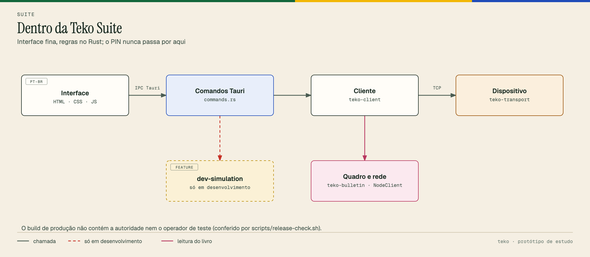

# Suite desktop

← [Índice da documentação](../README.md)

## Resumo
A **Teko Suite** é o app Tauri v2 (interface em HTML/CSS/JS, regras em Rust). Ela conversa com o dispositivo, o emissor e a rede, mas **nunca** tem campo de PIN nem vê chaves.

## Quem participa
Interface, comandos Tauri, `teko-client`, dispositivo, quadro e rede.

## Diagramas

*Fontes: [SVG](../diagramas/suite-arquitetura.svg) · [HTML](../diagramas/suite-arquitetura.html)*

## Passo a passo
1. `make emulator` (terminal 1): o PIN é digitado **aqui**.
2. `make suite` (terminal 2): onboarding guiado (inclui a **Carteira** e a frase de recuperação), identidade, **Carteira** (endereço e saldo de teste), assinar, votar e **Resultados**. Para ter saldo de teste: `make fund ADDR=<seu endereço> AMOUNT=1000`.
3. Sem emulador ligado a Suite abre no Explorador público.
4. Pré-visualização só visual: `make preview` (usa backend falso fora do pacote).

## O que é verificado e por quem
A Suite confere atestação, firmware e a cadeia do nó; as confirmações sensíveis são do dispositivo.

## O que pode dar errado
Resultados antigos ou eleição trocada: a Suite amarra o cache à primeira entrada do quadro. Dados de teste só aparecem no build de desenvolvimento.

## Onde está no código
`apps/suite/src-tauri/src/commands.rs`, `apps/suite/ui`, `crates/teko-client`, `crates/teko-transport`.

## Testes que cobrem
`crates/teko-client/tests/e2e.rs` (onboarding ponta a ponta sem janela) e `scripts/release-check.sh` (o build de produção não tem `dev-simulation` nem botões automáticos).

## Limites honestos
Botões automáticos do emulador existem apenas sob a feature `test-buttons`, nunca no build normal.
