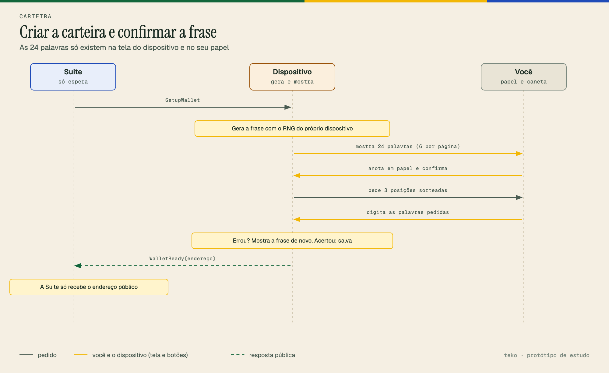
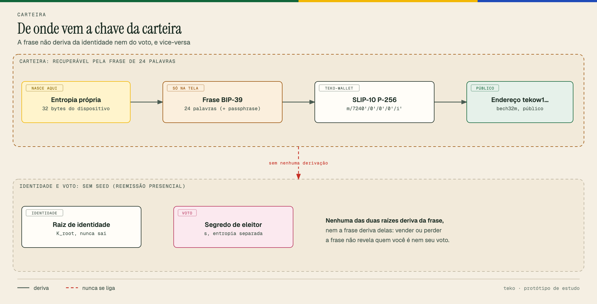

# Carteira e frase de recuperação

← [Índice da documentação](../README.md)

## Resumo
A carteira guarda o seu saldo e os seus bens. Como não existe autoridade que devolva dinheiro, ela tem uma **frase de recuperação de 24 palavras**, estilo carteira Bitcoin, criada e mostrada **só no dispositivo**. No onboarding o dispositivo confirma que você anotou pedindo **palavras de posições sorteadas** (estilo Trezor). A **identidade continua sem seed**: a frase não tem ligação com ela nem com o voto.

## Quem participa
Você (com papel e caneta), o dispositivo (tela e botões) e a Suite, que só espera e recebe o endereço público.

## Diagramas

*Fontes: [SVG](../diagramas/carteira-criar.svg) · [HTML](../diagramas/carteira-criar.html)*

*Fontes: [SVG](../diagramas/carteira-arvore.svg) · [HTML](../diagramas/carteira-arvore.html)*

## Passo a passo
1. **Criar:** na Suite, etapa "Carteira" (entre PIN e ID Cívico), clique em **Criar nova carteira**.
2. O dispositivo gera 32 bytes de entropia e mostra as **24 palavras na tela dele**, 6 por página; cada página é confirmada no botão. **Anote em papel**, na ordem.
3. O dispositivo pergunta se você quer uma **passphrase** (senha extra). Se sim, digita-se 2 vezes no dispositivo. **Esquecê-la = perder os fundos.**
4. Ele **sorteia 3 posições** (por exemplo 4, 11 e 19) e pede as palavras; você digita lendo do papel. Errou: a frase é mostrada de novo e outras posições são sorteadas (até 5 tentativas). Cancelou: nada é salvo.
5. Só então a carteira é gravada, e a Suite recebe o **endereço público** (`tekow1…`). Sem a carteira pronta, o dispositivo recusa o ID Cívico e a emissão da credencial.
6. **Restaurar** (dispositivo novo ou apagado): **Restaurar com minha frase**, digite as 24 palavras **no dispositivo**, informe a passphrase (se houver) e **confira o endereço** mostrado: uma frase errada gera outra carteira em silêncio, então o endereço é a prova.
7. **Verificar backup** (tela Carteira): o dispositivo pede a frase inteira e só diz se confere.

## O que é verificado e por quem
- O **dispositivo**: lista de palavras e checksum BIP-39, as palavras das posições sorteadas, a igualdade das duas digitações da passphrase.
- A **Suite**: só confere que o endereço recebido é bech32m válido e que corresponde à chave pública (`wallet_address`).
- Nenhuma mensagem do protocolo carrega palavra, entropia, semente ou passphrase.

## O que pode dar errado
- **Frase roubada** (foto, phishing, papel perdido): quem a tem controla os fundos. A Suite não tem campo para a frase de propósito; qualquer site que peça as 24 palavras é golpe.
- **Anotação errada ou passphrase esquecida:** fundos perdidos se o dispositivo também se perder; use "Verificar backup".
- **Importar em outra carteira:** a curva é P-256 com caminho próprio; a mesma frase em uma carteira Bitcoin dá outro endereço.

## Onde está no código
`crates/teko-wallet` (frase, SLIP-10, endereço), `crates/teko-device-core/src/device.rs` (`setup_wallet`, `restore_wallet`, `check_wallet_backup`, `get_address`), `crates/teko-protocol/src/messages.rs`, `tools/device-emulator/src/terminal.rs`, `apps/suite` (etapa e tela Carteira). Decisão: [ADR-0023](../adr/0023-carteira-com-seed-bip39.md); chaves: [KEY-HIERARCHY](../KEY-HIERARCHY.md) §3.1.

## Testes que cobrem
Vetores oficiais de BIP-39 e SLIP-10 (`crates/teko-wallet`), os testes `creating_a_wallet_shows_24_words_only_on_the_screen`, `a_wrong_word_shows_the_phrase_again…`, `restore_gives_the_same_address…` (device-core) e o ponta a ponta `a_wallet_restores_on_a_new_device_with_the_same_address`. Lista completa em [TEST-MATRIX](../TEST-MATRIX.md).

## Limites honestos
Emulador sem isolamento de hardware (a frase passa por um terminal comum; ele limpa a tela, mas não há garantia). Derivação própria sobre o crate `bip39`, **sem auditoria**. A carteira ainda **não assina transações** (`SignTransaction` é o próximo marco) e o saldo mostrado hoje vem de uma alocação de **moeda de teste** da devnet local (`make fund`), não de um livro na rede.
